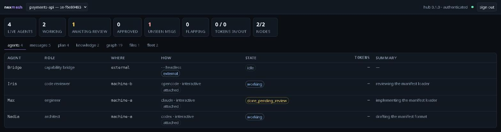
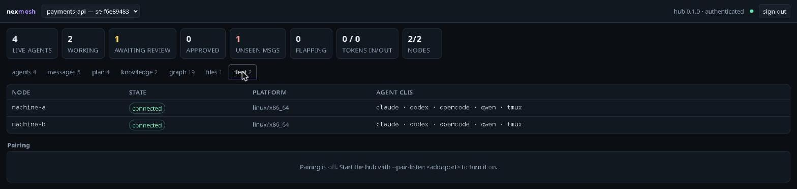

# nexmesh

Multi-agent orchestration for agent CLIs **across machines**.



*Four agents on two machines — an architect and an engineer on one, a reviewer
on another, and a capability bridge that is not a CLI at all. Every screenshot
here comes from `tests/demo-fleet.py`, which stands the whole thing up locally
in about a minute.*

## Credits

**nexmesh is a reimplementation of
[multiagents](https://github.com/zetbrush/multiagents) by Arman Andreasyan
([@zetbrush](https://github.com/zetbrush)).** That project worked out what a
team of agent CLIs actually needs in order to function as a team, and nexmesh
would not exist without it. If you want this on a single machine, use the
original — it is the more mature tool, and it is where these ideas come from.

The design nexmesh inherits from it, essentially unchanged:

- **The slot/peer split** — a *slot* is a seat on the team with a stable
  identity; an *agent* is whatever process is currently filling it. This is the
  idea that makes crash recovery and respawning coherent, and everything else
  here is built on it.
- **The task state machine** — `idle → working → done_pending_review →
  addressing_feedback → approved → released`, with reviewer roles
  self-approving, and agents unable to disconnect until the loop completes.
- **Delivery with acknowledgement** — a message counts as delivered only once
  it has actually been surfaced to the model, so a dropped hand-off is retried
  instead of lost.
- **Piggybacking delivery on MCP tool results** — prepending unread messages to
  an agent's next tool result, under a `[PENDING MESSAGES]` header. This is the
  trick that makes an arbitrary MCP-speaking CLI usable with no bespoke code,
  and it is the floor the whole plugin model here stands on.
- **The shared knowledge store** — a persistent key-value store of decisions,
  conventions and discoveries, on the diagnosis that context drift between
  agents is the main way these systems fail.
- **File locks plus ownership zones** — static zones for cheap separation,
  dynamic locks for genuinely shared files.
- **Driving a headless CLI through its stdin** — writing teammate messages into
  `claude -p --input-format stream-json` so they are read mid-turn rather than
  at the end of it, and using Codex's `turn/steer` for the same purpose.

Rediscovering any one of those would have taken weeks. The credit for the
system design belongs upstream; what follows is only about running it on more
than one machine.

### The code graph comes from graphify

**The idea behind [Reading a codebase once](docs/GUIDE.md#reading-a-codebase-once-not-once-per-agent)
is [graphify](https://github.com/Graphify-Labs/graphify) by Graphify Labs**
(Apache-2.0, also offered under MIT). It was evaluated as a dependency and
reimplemented instead; what it contributed is the shape of the answer:

- **Parse the codebase deterministically and query the graph**, rather than
  asking a model to read files. graphify's own framing — tree-sitter, no
  embeddings, no vector store, nothing leaving the machine — is the reason the
  code graph here works the same way.
- **Say which edges are facts and which are guesses.** graphify tags edges
  `EXTRACTED` or `INFERRED`. `EdgeKind::is_certain` is that distinction, and
  carrying it all the way to the agent is a direct borrowing: a resolved-by-name
  call must not read like a syntax fact.
- **Communities as de facto subsystems.** graphify detects them with Leiden;
  so does this, for the same purpose — handing an agent one subsystem instead
  of a repository.
- **Ingest more than code.** Its coverage of docs, PDFs and images is why the
  capability bridge exists at all, though the division is different here: that
  work belongs to an *agent* writing into memory, because nexmesh holds no
  model credentials.

What was **not** taken: any of its code. graphify is Python; this is Rust, and
the Leiden implementation, the language table, the storage and the query
surface were written here. Nothing was copied, adapted or translated, and the
permissive licence was not relied on to vendor anything.

What is deliberately **not** reimplemented: its LLM semantic pass over PDFs,
images and audio, and its HTML report. The first needs model credentials,
which nexmesh refuses to hold; the second is better served by an agent that
can already read.

If you want a code knowledge graph on its own, use graphify — it is the more
capable tool at that one job, and it is where this idea comes from.

## What nexmesh changes

multiagents is single-host by construction — a reasonable choice for its
purpose, and not a flaw. But a fleet breaks four of its assumptions, and none
of the four is a port away:

| Original | Problem across machines | Here |
|---|---|---|
| `process.kill(pid, 0)` on pids from the DB (`broker.ts:326,372,593,1658`) | Every node has a pid 4242. A hub probing or signalling a remote agent's pid hits an unrelated **local** process. | Identity is `(node_id, pid, start_ticks)`. The hub cannot signal anything; only the owning node can, after verifying the triple. |
| No auth anywhere on the broker HTTP API | The API spawns processes, so exposing the socket is RCE. | Per-node enrolment tokens, SHA-256 at rest, verified before any frame is honoured. The token decides identity, so a node can't claim another's history. |
| `Bun.spawn` + stdio pipes in the orchestrator | A pipe does not cross a machine boundary, so the driver must live where the CLI does. | A `node` daemon per machine owns spawning and driving. This component has no equivalent in the original. |
| Locks keyed `(session_id, file_path)` | `src/**` on machine-a is not `src/**` on machine-c. | Locks are keyed by **scope**: `node:<id>` for local work, `ws:<id>` for a tree several machines hold. |

Plus: its three bespoke CLI drivers become declarative descriptors, so adding
a CLI is a TOML file rather than a Rust change — and an agent no longer has to
be a CLI at all.

## Shape

```
       machine B (roaming)            machine A (always on)         any other machine
  ┌──────────────────────┐      ┌───────────────────────┐      ┌──────────────────────┐
  │ nexmesh-node         │      │     nexmesh-hub       │      │ nexmesh-node         │
  │  spawns + drives     │─────▶│  SQLite: sessions,    │◀─────│  spawns + drives     │
  │  local CLIs          │  WS  │  slots, agents,       │  WS  │  local CLIs          │
  │                      │ (out)│  messages, locks,     │ (out)│                      │
  │ claude   opencode    │      │  memory, code graph   │      │ codex    qwen        │
  │   └─ nexmesh-mcpd ───┘      └───────────────────────┘      └─── nexmesh-mcpd ─┘   │
  └──────────────────────┘          ▲             ▲            └──────────────────────┘
                                    │             │
                          web dashboard      nexmesh-orch
                                              (MCP, in any CLI)
```

A node **always dials out** to the hub and holds one WebSocket; the hub never
connects to a node. Spawns, kills, message injection and interactive attach are
all multiplexed over that socket. That single choice is why a node works
unchanged on a roaming machine, behind NAT, or on a public host with no inbound
port — so starting with two machines does not paint us into a corner.

### Seats, conversations and sessions

Three things that are easy to conflate, and the whole model turns on keeping
them apart:

```
  CONVERSATION                SEAT (slot)                 SESSION (team)
  one CLI window              a stable identity           a workspace, a message
  CLAUDE_CODE_SESSION_ID      on a team                   log, file locks, a budget
        │                           │                            │
        └───── claims ──────────────┤                            │
                                    └──────── belongs to ────────┘
                                         (and can be moved)

  claude  ──┐
  claude  ──┼── 3 conversations, 3 seats ───▶  digesta    ─┐
  claude  ──┘    (one machine, one folder)                 ├─ one fleet
  claude  ───── 1 conversation, 1 seat  ───▶  coderai     ─┘
  hermes  ───── not a CLI at all        ───▶  lisa
```

A **conversation** is one CLI window; its own id is what makes a seat the same
seat across a restart or a `/resume`. A **seat** is a place on a team that
outlives whatever process is in it — that is what makes crash recovery
coherent. A **session** is the team: one workspace, one message log, one lock
domain, one budget.

Many conversations map into one session. A conversation belongs to exactly one
session at a time and can be moved between them without restarting. A
directory is a *default* for a conversation that has never been placed, never a
verdict: two agents in one folder may be on different teams, and one team's
seats may sit in a dozen folders on half a dozen machines.

### Who may drive what

```
      super orchestrator ─────────────── the whole fleet, and who is where
        (token with no scope)            ▲         ▲         ▲
                                         │         │         │
                                    operator channel (message_supervisor)
                                         │         │         │
      scoped orchestrators ──────▶  digesta    coderai    motus
        (token --session X)          one team each: cannot see, touch or
                                     discover another session

      agents ────────────────────▶  their own session only. resolve_peer
                                    never sees a seat on another team.
```

An operator token carries a scope. Without one it is a **super** orchestrator:
every session, and the only thing that may create one or move a seat between
two. With `--session` it drives one team and cannot learn that any other
exists. A scoped orchestrator reaches past itself the only honest way — by
asking someone whose reach is wider.

Agents never cross. A session is a unit of isolation, and `resolve_peer` only
ever sees seats in the agent's own session — but an agent can raise its hand
with `notify_operator`, which reaches its own team's orchestrator first and
the supervisors when there is none, or when the one there has gone quiet.

## Binaries

| Binary | Runs on | Owns |
|---|---|---|
| `nexmesh-hub` | one host | All state. Decides what runs where. **Cannot signal a process.** |
| `nexmesh-node` | every machine | Spawns local CLIs, drives them, reports health. The only component that may signal. |
| `nexmesh-mcpd` | per agent, stdio | The MCP shim the CLI loads. Talks to its local node over a unix socket; holds no credentials. |
| `nexmesh` | anywhere | Operator CLI. |
| `nexmesh-orch` | wherever you work | The orchestrator, as an MCP server, so **any** MCP-capable CLI can run the fleet. |
| `nexmesh-coderai` | beside a media/OCR service | A capability bridge: joins as a participant, offers OCR, transcription, speech, embeddings, images. The only component holding that service's token. |

## Quick start

```bash
rustup target add x86_64-unknown-linux-musl     # static, for copying to other machines
export CC_x86_64_unknown_linux_musl=musl-gcc
cargo build --release --workspace --target x86_64-unknown-linux-musl
```

On the hub machine:

```bash
nexmesh-hub enrol machine-a                 # once per node; prints its token
nexmesh-hub operator-token me               # a super orchestrator's token
nexmesh-hub --listen 127.0.0.1:7870 serve
```

On each node:

```bash
NEXMESH_TOKEN=<from enrol> nexmesh-node --hub ws://hub:7870 --clis /etc/nexmesh/clis
```

Then make the CLI you already use a member of the team — every conversation
you start in it takes its own seat:

```bash
nexmesh install-seat --cli claude --role engineer
nexmesh move-agent <seat> <session>         # place it once; it stays placed
```

Or let the fleet start the agents for you, from whatever CLI you prefer:

```bash
nexmesh install-orchestrator --cli claude --token <operator-token>
# then, in that CLI: "start a team on machine-a: a claude engineer to build
# the login flow and an opencode reviewer; the repo is at /srv/app"
```

[The guide](docs/GUIDE.md) has the rest: building and installing properly,
the dashboard behind nginx, mutual TLS, and every surface below.

## Seeing it without installing anything

```bash
tests/demo-fleet.py
```

Stands up a hub, two nodes, four agents, a session awaiting review and a
parsed code graph — locally, in about a minute, on ports in the 17900s. It
prints a URL and a dashboard login. Nothing it starts is a billable CLI:
`tests/fake-cli` is on the nodes' PATH, so "launch" starts a harmless fake.
Every screenshot in this repository comes from it.



## What is where

| | |
|---|---|
| **[The guide](docs/GUIDE.md)** | everything below, in detail |
| [Sessions, seats and who joins what](docs/GUIDE.md#sessions-seats-and-who-joins-what) | how a conversation finds its team, moving between them, what a lock arbitrates, shared workspaces |
| [Driving the fleet](docs/GUIDE.md#driving-the-fleet) | scoped and super orchestrators, the operator channel, watching, messaging, pausing, budgets |
| [Agents, and what counts as one](docs/GUIDE.md#agents-and-what-counts-as-one) | adding a CLI, writing a driver plugin, agents that are not CLIs, capability asks, the bridge |
| [What the team knows](docs/GUIDE.md#what-the-team-knows) | the code graph read once per codebase, memory with a scope |
| [Terminals, failure and recovery](docs/GUIDE.md#terminals-failure-and-recovery) | attach from anywhere, crash recovery, adopting a running tmux session |
| [Running it for real](docs/GUIDE.md#running-it-for-real) | installing, the dashboard, mutual TLS, deployment |
| [tests/README.md](tests/README.md) | the twenty-three end-to-end suites, and what each one guards |

## Status

Working, and running a real fleet. The wire protocol, schema, CLI detection,
token enrolment and lease-based liveness are settled; so is the whole chain
from a hub placing a slot to a node spawning a CLI, writing its MCP config and
reporting the exit — and the other direction, where a CLI started by hand
takes a seat and becomes a full team member.

- 339 unit tests and **twenty-three end-to-end suites** that drive real
  processes (`tests/README.md`). None of them spends API credits, and a suite
  that prints no verdict counts as a failure.
- All 26 team tools, the review state machine, lock domains, shared knowledge,
  memory with a scope, the plan, token accounting and budgets.
- Delivery with acknowledgement: messages ride back on any tool result under
  `[PENDING MESSAGES]` and count as delivered only once the shim has written
  them to its CLI. An agent that dies first releases them for whoever fills
  that seat next.
- Operators: `nexmesh` for the fleet, `nexmesh-orch` as an MCP server so any
  CLI can drive it, and a web dashboard with its own login.

```bash
cargo test
tests/run-all.sh      # a suite printing no verdict counts as a failure
tests/demo-fleet.py   # the whole thing, locally, in about a minute
```

## License

GNU General Public License v3.0 or later. See [LICENSE](LICENSE).

On the relationship to the upstream project: nexmesh is an independent
implementation in Rust. It reuses the *design* credited above and **none of the
source code** of [multiagents](https://github.com/zetbrush/multiagents), which
is TypeScript/Bun and declares MIT in its `package.json` and README (that
repository carries no `LICENSE` file). No upstream file was copied, adapted or
translated; the schema, wire protocol and every line here were written from
scratch. The GPLv3 therefore covers this work only, and takes nothing away from
the original.
