# nexmesh

**One team of AI agents, across every machine you own.**

nexmesh runs agent CLIs (Claude Code, Codex, opencode, qwen, gemini, anything
that speaks MCP) on as many machines as you like and makes them one team: one
message log, one shared memory, one plan, one set of file locks. You watch it
and drive it from a terminal, a browser or a phone, and you can attach to any
agent's real terminal from anywhere.

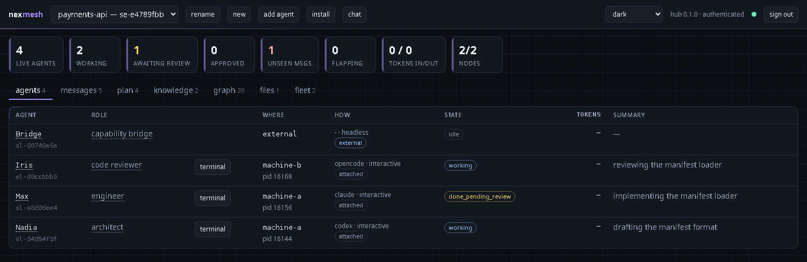

*Four agents on two machines: an architect and an engineer on one, a reviewer
on another, and a capability bridge that is not a CLI at all. Every screenshot
here comes from `tests/demo-fleet.py`, which stands the whole thing up locally
in about a minute.*

Written at [Nexlab](https://www.nexlab.net) by Stefy Lanza, and in daily use on
a real fleet.

---

## What it does

### Agents on any machine, one team

A **node** daemon on each machine spawns and drives the CLIs installed there.
The **hub** holds all the state and decides what runs where. The node always
dials out and holds one WebSocket, so a laptop behind NAT, a roaming machine
and a public host with no inbound port all work the same way. Spawns, kills,
message injection and interactive attach are multiplexed over that one socket.

The hub cannot signal a process. Only the machine that owns it can, after
verifying `(node, pid, start_ticks)`. A pid from another machine is a number,
not a process.

### Any CLI, and agents that are not CLIs at all

Adding a CLI is a TOML descriptor rather than a code change: how to find the
binary, how to register the MCP shim, how to launch it headless and
interactive, and which driver can steer it mid-turn.

Delivery has three tiers. Any MCP-speaking CLI works at the floor, because
messages ride back on the next tool result. Claude's `stream-json` and Codex's
app-server get mid-turn injection. A plugin binary covers anything odd. A CLI
with no driver at all can still be typed at, if its descriptor says that its
interactive mode is the agent's own prompt.

A teammate does not have to be a model. The **capability bridge** joins as an
ordinary participant and offers what a language model cannot do by itself: OCR,
transcription, speech, embeddings, image and video work. Agents reach it with
`ask_capability` and get the answer back in their own conversation. The bridge
shipped here talks to [CoderAI](https://www.nexlab.net), Nexlab's media and
inference service, and what it offers is described in a manifest
(`capabilities/coderai.toml`) rather than compiled in, so another service can
go behind the same bridge by writing a different manifest.

### Your own CLI, as a seat on the team

```bash
nexmesh install-seat --cli claude --role engineer
```

From then on every conversation you start in that CLI takes its own seat, keyed
on the CLI's own conversation id, so it survives a restart, a `/resume` or
being moved to another team. Or start one the fleet owns from the first
keystroke:

```bash
nexmesh run claude          # a seat, a pty the fleet owns, attachable at once
```

### Attach to anything, from anywhere

```bash
nexmesh attach payments Engineer
```

The real terminal, not a transcript. When you and the agent are on the same
machine the keystrokes go straight to the node: the hub mints a one-time ticket
and carries none of the bytes. From outside the LAN the same command relays
through the hub instead, and tells you which route it took.

The same terminal opens in the browser, including on a phone. A CLI you started
by hand in tmux can be **adopted**, so the fleet can watch and type at it
without disturbing your own attachment.

### A console, in the terminal

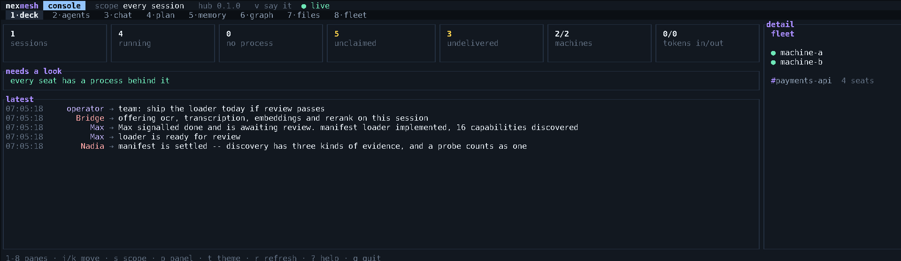

`nexmesh`, run bare from a terminal, puts the whole fleet on one screen. The
deck is what you want before you know what you are looking for: the tiles,
anything that needs a look, and the traffic as it arrives.

The **agents** pane is the one you work in. Sort by any column, and make a
seat, start it, move it, rename it or remove it without leaving the screen. `a`
attaches:

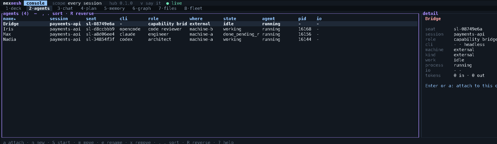

The **code graph**, drawn in braille: subsystems on a ring, sized by what is in
them, with the heaviest dependencies between them and the cursor's own edges
picked out. Only the big ones are labelled, to keep the labels readable:

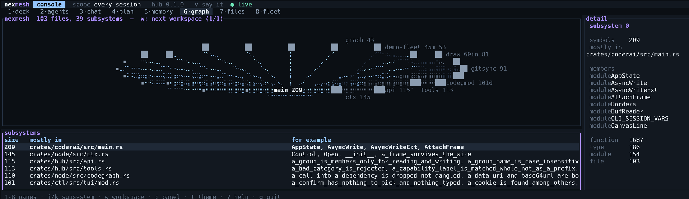

The **chat** is laid out like IRC: channels down one side, the room in the
middle, who is in it on the right. A line starting with `/` is a command:

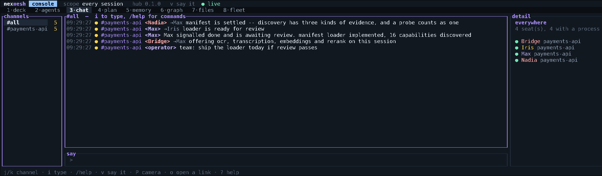

**Memory** is a table of what the team knows. Enter opens one in full, since a
memory is usually a paragraph and a column six words wide is no place to read
one:

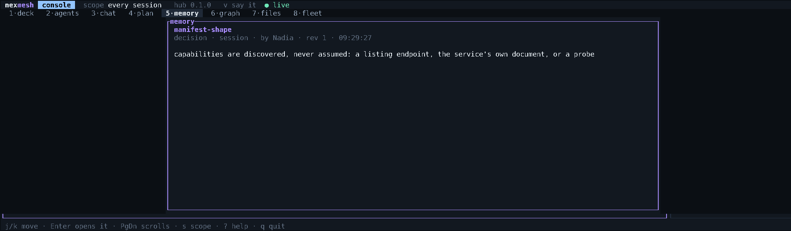

Two themes, remembered per machine, and the second one is not subtle:

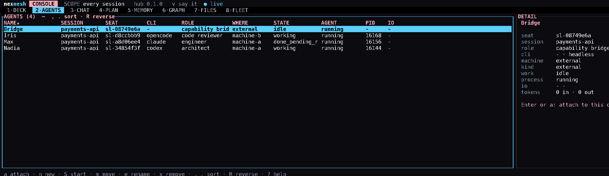

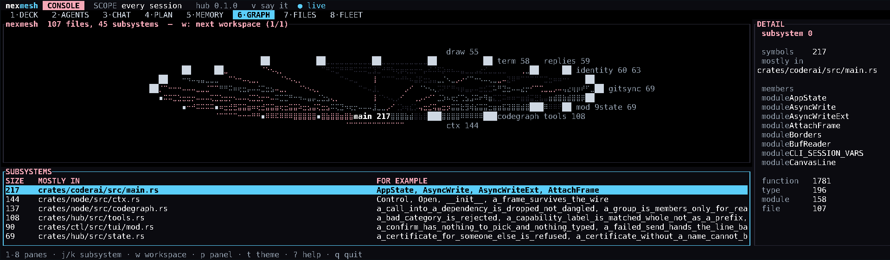

### Chat with your fleet, and commands in the chat

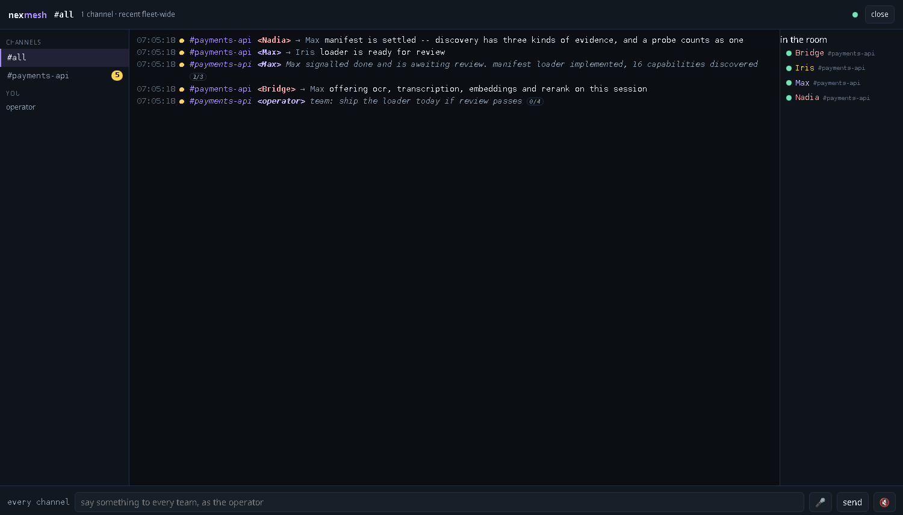

The chat is IRC-shaped: a channel per session plus `#all`, one line per
utterance, who is in the room down the side, and a delivery mark that says what
it means. `seen by 2 of 3` is more use than a tick. Reply to one agent, or say
it to the team.

A line beginning with `/` is an instruction instead of an utterance:

```
/rename Dev the new dev
/move Dev #payments
/start Dev interactive
/new claude Reviewer
/remove Dev force
```

The hub reads those, so the console, the dashboard and the phone all have them
with nothing installed.

A picture someone hands the team is shown in the line that announced it, and
opens full size on a click. The hub stores no files, so it fetches the bytes
back from the machine the file was written to.

### Talk to it, and have it talk back

Speech in both directions, wherever the chat is. The fleet needs a teammate
advertising `transcribe` (speech to text) and `tts` (text to speech), which the
capability bridge provides; nothing is sent to a cloud that the fleet is not
already talking to.

**Dictation** works in the browser, in the installed app on a phone, and in the
console (`v` to say it, `V` to have new messages read aloud). It works inside an
attached terminal too, which is the practical way to put a sentence into an
agent's prompt one-handed. There it lives behind a mode rather than taking keys
the agent needs: `Ctrl-\` turns command mode on, the bottom row changes colour,
and then `Ctrl-G` records, `Ctrl-O` reads the last reply aloud, `Ctrl-T` reads
every new one, and `Ctrl-]` detaches. While the microphone is open the whole
bottom row turns red and counts the seconds, because a mode you cannot see is a
microphone you forget is on.

**Hands-free** (`Ctrl-N`) keeps listening instead of asking for a keypress at
each end of every sentence: it starts on sound, stops after two seconds of
quiet, transcribes what you said into the prompt, and listens again until you
turn it off. It needs sox, the only recorder that can be asked to end a
sentence by itself.

**Reading back** is the other direction: one reply on request, or every new
reply as it arrives, spoken through the same bridge. A long answer is split to
fit the model's context and the pieces are joined back into one, so a
paragraph is read as a paragraph.

Nothing is submitted for you. Enter stays yours.

### A dashboard that is also an app

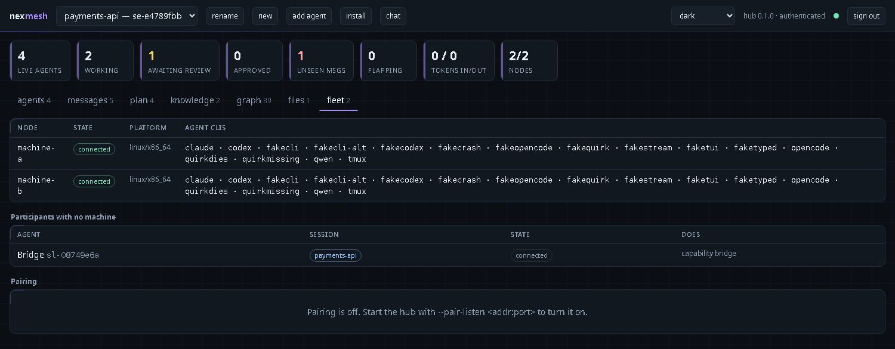

Served by the hub itself, with no CDN and no external font. A fleet hub may sit
on a network with no route to the internet, and the dashboard still has to
render there. It installs as a PWA, and on a phone the tables become cards
instead of something to scroll sideways.

| | |
|---|---|
| 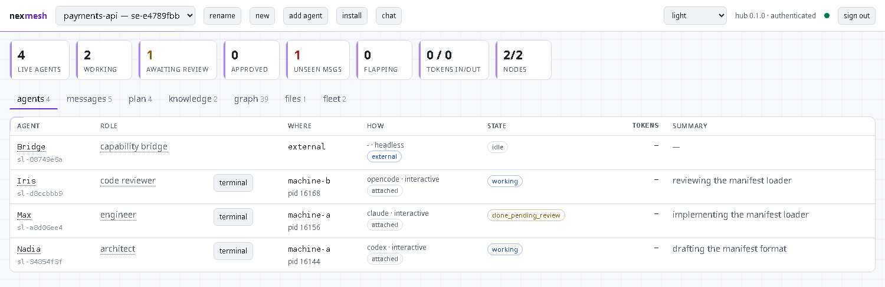 | 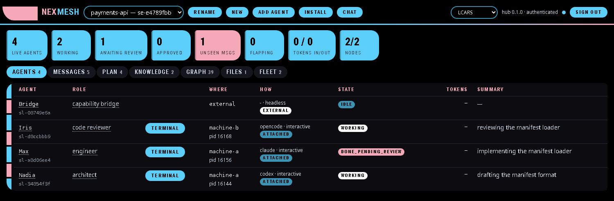 |

<p align="center">
  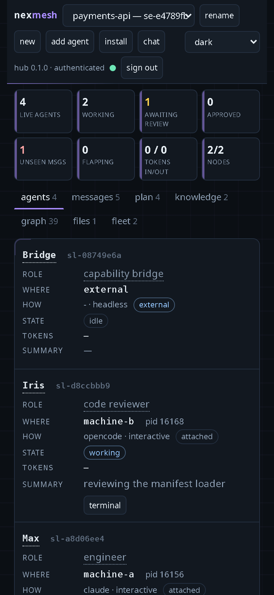
  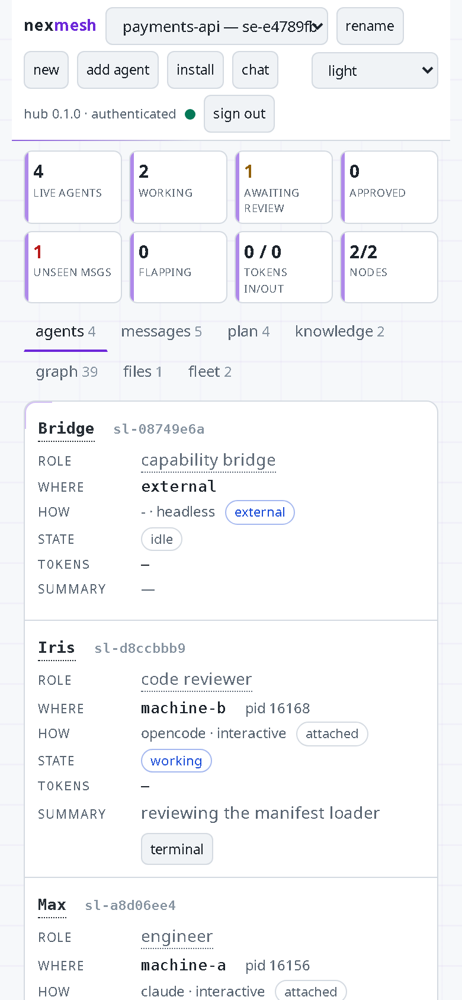
  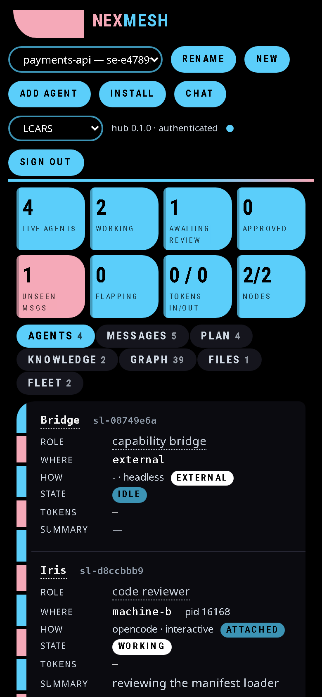
</p>

### A headset, in two modes

<video src="docs/images/xr-tour.mp4" poster="docs/images/xr-team.png"
       controls muted loop playsinline width="100%">
  <a href="docs/images/xr-tour.mp4">A walk through the room (mp4)</a>
</video>

*A camera that never stops moving is the worst case for a gif, so this is an
mp4: sharper, and a third the size one would have been.
[Download it](docs/images/xr-tour.mp4) if your viewer will not play it here.*

In a headset the dashboard is a window you can leave floating over whatever
else is running, which is the useful thing most of the time: a game or a
workspace in front of you, the fleet off to one side. It is the same PWA, so
it installs and behaves the same way.

`/xr` is the other mode: the team standing in the room with you.

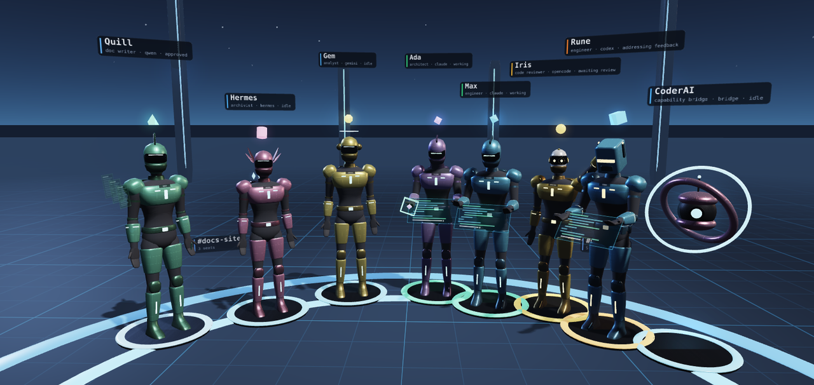

Every teammate is a figure in a suit, and everything about it says something,
so a glance across the room is a status report:

| | |
|---|---|
| **the helmet** | which CLI it is. A smooth dome, a block with a slit, an open android face, a crest, twin lobes, wings |
| **the armour** | its role, and so does what it carries: a reviewer has a lens, an architect a blueprint turning over one hand, an engineer a belt of tools, an archivist crystals racked on its back |
| **the lit strips** | what it is doing. Green working, amber awaiting review, blue at rest, dark when paused |
| **the pose** | the same thing again, for a glance from across the room: one that is working is typing at a console, one awaiting review has its hand up, one with no process stands with its head down |

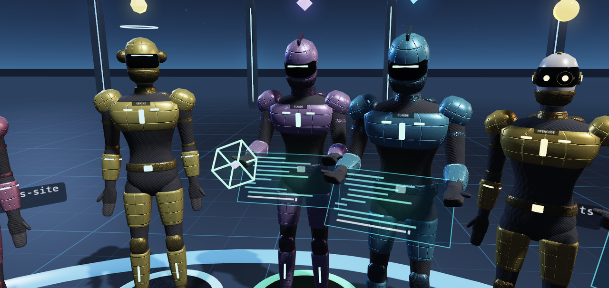

**Click a teammate and their terminal opens**, above them, facing you. It is an
attach rather than a transcript: the real screen, with the agent's own cursor,
drawn by the same VT emulator the dashboard uses. **There is a keyboard in the
room**, so a path, a flag or a Ctrl-C can be typed at an agent without taking
the headset off; a flat screen types into the focused terminal directly.

The chat is another screen, and the menu — the team, the code map, the chat, a
terminal, the keyboard, speech, one line per team, and the dashboard's own tabs
for the machines, the plan, what the team knows and what is locked — is mounted
on your left wrist in a headset, so it is reachable from anywhere in the scene.
A ray lands on a button exactly as it lands on a person. Screens can be moved
with one hand and resized with two, or with the wheel on a flat screen.

| | |
|---|---|
| 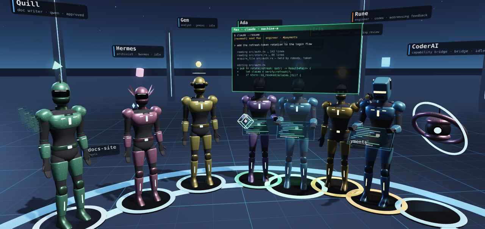 | 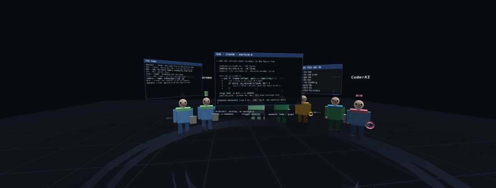 |

The code graph becomes a thing with a far side. Subsystems carry three
channels at once: **size** is how much is in one, **shape** is what it is
mostly made of (functions, types, traits, files), and **colour** is where it
lives in the tree, so one crate is one colour. Dependencies are drawn between
them, solid for facts read off the tree and thin for guesses, and the selected
subsystem's own edges are picked out.

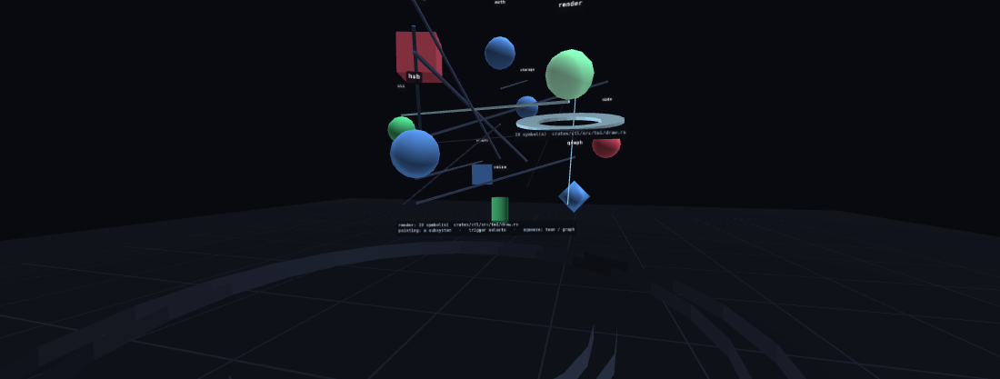

Your own arms are drawn where the headset says your hands are, elbows worked
out from your shoulders, in the same suit the team wears. **Grab empty space
and the room moves past you**; grab a subsystem and it follows your hand; grab
a screen and it comes with you, turning to stay readable; the thumbsticks
slide and snap-turn for anyone who prefers that. A fleet running several teams
at once is a crowd until you ask for one of them, so the menu lists them and
the room rebuilds around the one you pick. Speech is the
input that suits a headset, since there is no keyboard: the trigger on empty
space starts listening, and what you say is a command ("the code graph"), a
name ("Iris"), or a sentence, which goes to whoever is selected or to the
team.

It is WebGL2 and WebXR written directly, with no 3D library, for the same
reason the dashboard has no CDN: a hub on a network with no route to the
internet still has to render. Everything in the room is procedural —
superellipse cross-sections lofted into surfaces, a shadow map, a physically
based surface model, and relief that is woven fabric on a sleeve and panel
lines on a plate. Without a headset the same scene draws to a canvas with a
mouse, which is how the pictures above were taken, by `tests/xr-shots.py`.

### Reading a codebase once, not once per agent

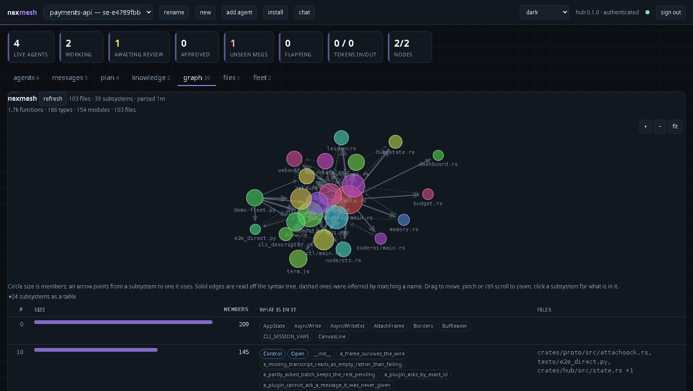

tree-sitter over the whole workspace, once: definitions, calls, imports, and
subsystems found with Leiden. Agents ask questions (what calls this, what does
this file import, which subsystem is this in) instead of spending a context
window reading files. Every edge says whether it is a fact or a guess, so a
call resolved by name does not read like a syntax fact. No embeddings, no
vector store, nothing leaves the machine.

### Hand the team a file, from wherever you are

An agent reads files, so an upload goes into the session's workspace on a
machine that holds it, and the path is said in the chat:

```bash
nexmesh upload payments ./spec.pdf --say 'the API we have to match'
```

In the browser and the installed app it is the paperclip beside the chat, and
beside an open terminal, where it lands on that agent's machine in the
workspace that seat works in. The camera button next to it does the same with a
photo or a clip, from the phone in your hand or the webcam on the machine you
are typing at. `nexmesh camera` is the same thing from a terminal. A model that
cannot read a PDF asks the capability bridge to OCR it, with the same
`ask_capability` it uses for anything else.

### One repository, several agents, no collisions

Say which parts of a workspace each agent is responsible for, by container,
directory or subsystem, and the team hands work to each other instead of
editing over each other:

```
/owns Max verti/** ombia        # from the chat, wherever you are reading it
/owns Iris +verti/db/**         # a carve-out; the longest pattern wins
```

Teammates see it in `list_peers`, ask `who_owns <path>` before touching
anything they did not write, and are told whose area a file is in when they
take a lock. An orchestrator that can see the whole fleet can also
`delegate_task` into another team: the work lands in that team's plan, owned by
the agent that is going to do it.

### What the team knows, and what it is doing

Shared memory with a scope (this session, or the whole fleet). A plan with an
owner per step. File locks keyed by domain: `node:<id>` for one machine's own
files, `ws:<id>` for a tree several machines hold a copy of. Ownership zones
for cheap separation. Token accounting, and a budget that can pause a session
before it spends the month.

A review state machine the agents cannot skip: `idle → working →
done_pending_review → addressing_feedback → approved → released`, with
reviewers self-approving and nobody disconnecting mid-loop.

### Security that assumes the network is real

Per-node enrolment tokens, hashed at rest. An operator token carries a scope:
without one it is a super orchestrator and sees the whole fleet; with
`--session X` it drives one team and cannot learn that another exists. Agents
never cross sessions. Mutual TLS from a fleet CA the hub runs itself, with
one-time pairing codes for operators and revocation that takes effect at the
handshake. The hub holds no model credentials and no service tokens. The bridge
holds one service token and nothing else.

---

## Shape

```
       machine B (roaming)            machine A (always on)         any other machine
  ┌──────────────────────┐      ┌───────────────────────┐      ┌──────────────────────┐
  │ nexmesh-node         │      │     nexmesh-hub       │      │ nexmesh-node         │
  │  spawns + drives     │─────▶│  SQLite: sessions,    │◀─────│  spawns + drives     │
  │  local CLIs          │  WS  │  slots, agents,       │  WS  │  local CLIs          │
  │                      │ (out)│  messages, locks,     │ (out)│                      │
  │ claude   opencode    │      │  memory, code graph   │      │ codex    qwen        │
  │   └─ nexmesh-mcpd ───┘      └───────────────────────┘      └─── nexmesh-mcpd ─┘   │
  └──────────────────────┘          ▲             ▲            └──────────────────────┘
                                    │             │
                          web dashboard      nexmesh-orch
                                              (MCP, in any CLI)
```

### Seats, conversations and sessions

Three things that are easy to conflate, and the model depends on keeping them
apart:

```
  CONVERSATION                SEAT (slot)                 SESSION (team)
  one CLI window              a stable identity           a workspace, a message
  CLAUDE_CODE_SESSION_ID      on a team                   log, file locks, a budget
        │                           │                            │
        └───── claims ──────────────┤                            │
                                    └──────── belongs to ────────┘
                                         (and can be moved)
```

A **conversation** is one CLI window. Its own id is what makes a seat the same
seat across a restart or a `/resume`. A **seat** outlives whatever process is
in it, which is what makes crash recovery coherent. A **session** is the team:
one workspace, one message log, one lock domain, one budget. A directory is a
default for a conversation that has never been placed, not a verdict.

## Binaries

| Binary | Runs on | Owns |
|---|---|---|
| `nexmesh-hub` | one host | All state. Decides what runs where. Cannot signal a process. |
| `nexmesh-node` | every machine | Spawns local CLIs, drives them, reports health. The only component that may signal. |
| `nexmesh-mcpd` | per agent, stdio | The MCP shim the CLI loads. Talks to its local node over a unix socket; holds no credentials. |
| `nexmesh` | anywhere | Operator CLI, and, run bare from a terminal, the operator console. |
| `nexmesh-orch` | wherever you work | The orchestrator, as an MCP server, so any MCP-capable CLI can run the fleet. |
| `nexmesh-coderai` | beside a media or OCR service | The capability bridge, talking to [CoderAI](https://www.nexlab.net) or to anything else a manifest describes. The only component holding that service's token. |

## Quick start

```bash
curl -fsSL https://raw.githubusercontent.com/nextime/nexmesh/main/packaging/install.sh | sh
```

Static musl binaries: no libc version to match, nothing to compile. There are
`.deb` and `.rpm` packages too, and building from source is three lines.
[packaging/](packaging/README.md) has all three.

On the hub machine:

```bash
nexmesh-hub enrol machine-a                 # once per node; prints its token
nexmesh-hub operator-token me               # a super orchestrator's token
nexmesh-install hub                         # installs it, enables it at boot
```

On each machine:

```bash
nexmesh-install node --user alice            # one node per login
```

`nexmesh-install` (`deploy/install-service.sh` in a checkout) installs the
systemd unit or the `/etc/init.d` script, whichever this machine actually runs,
enables it at boot and starts it. `--dry-run` shows what it would do first.
Then make the CLI you already use a member of the team:

```bash
nexmesh install-seat --cli claude --role engineer
nexmesh move-agent <seat> <session>         # place it once; it stays placed
```

Or let the fleet start the agents for you, from whatever CLI you prefer:

```bash
nexmesh install-orchestrator --cli claude --token <operator-token>
# then, in that CLI: "start a team on machine-a: a claude engineer to build
# the login flow and an opencode reviewer; the repo is at /srv/app"
```

[The guide](docs/GUIDE.md) has the rest: building and installing properly, the
dashboard behind nginx, mutual TLS, and every surface above.

## Seeing it without installing anything

```bash
tests/demo-fleet.py
```

Stands up a hub, two nodes, four agents, a session awaiting review and a parsed
code graph, locally, in about a minute, on ports in the 17900s. It prints a URL
and a dashboard login. Nothing it starts is a billable CLI: `tests/fake-cli` is
on the nodes' PATH, so "launch" starts a harmless fake. Every screenshot in
this repository comes from it.

## What is where

| | |
|---|---|
| **[The guide](docs/GUIDE.md)** | everything above, in detail |
| [Sessions, seats and who joins what](docs/GUIDE.md#sessions-seats-and-who-joins-what) | how a conversation finds its team, moving between them, what a lock arbitrates, shared workspaces |
| [Driving the fleet](docs/GUIDE.md#driving-the-fleet) | scoped and super orchestrators, the operator channel, the console, chat commands, watching, messaging, pausing, budgets |
| [Agents, and what counts as one](docs/GUIDE.md#agents-and-what-counts-as-one) | adding a CLI, writing a driver plugin, agents that are not CLIs, capability asks, the bridge |
| [What the team knows](docs/GUIDE.md#what-the-team-knows) | the code graph read once per codebase, memory with a scope |
| [Terminals, failure and recovery](docs/GUIDE.md#terminals-failure-and-recovery) | attach from anywhere, crash recovery, adopting a running tmux session |
| [Running it for real](docs/GUIDE.md#running-it-for-real) | installing and starting at boot, the dashboard and its themes, the chat room, a terminal in the browser, mutual TLS |
| [deploy/](deploy/README.md) | a real deployment, service files for systemd and sysvinit, nginx |
| [tests/README.md](tests/README.md) | the end-to-end suites, and what each one guards |
| `man nexmesh` ([source](docs/man/nexmesh.1)) | every command and which argument is which, at the terminal |
| [docs/CREDITS.md](docs/CREDITS.md) | what this inherits, and from whom |

## Status

Working, and running a real fleet. The wire protocol, schema, CLI detection,
token enrolment and lease-based liveness are settled, as is the whole chain
from a hub placing a slot to a node spawning a CLI, writing its MCP config and
reporting the exit, and the other direction, where a CLI started by hand takes
a seat and becomes a full team member.

- 538 unit tests and **30 end-to-end suites** that drive real processes
  (`tests/README.md`). None of them spends API credits, and a suite that prints
  no verdict counts as a failure.
- All 32 team tools, the review state machine, lock domains, shared knowledge,
  memory with a scope, the plan, token accounting and budgets.
- Delivery with acknowledgement: messages ride back on any tool result under
  `[PENDING MESSAGES]` and count as delivered only once the shim has written
  them to its CLI. An agent that dies first releases them for whoever fills
  that seat next.
- Operators: `nexmesh` for the fleet, `nexmesh-orch` as an MCP server so any
  CLI can drive it, and a web dashboard with its own login.

```bash
cargo test
tests/run-all.sh      # a suite printing no verdict counts as a failure
tests/demo-fleet.py   # the whole thing, locally, in about a minute
```

## Credits

nexmesh is a reimplementation of
**[multiagents](https://github.com/zetbrush/multiagents) by Arman Andreasyan
([@zetbrush](https://github.com/zetbrush))**, the project that worked out what
a team of agent CLIs needs in order to function as a team. The slot and peer
split, the review state machine, delivery with acknowledgement, piggybacking
messages on MCP tool results, the shared knowledge store, locks with ownership
zones: all of that is its design, and nexmesh would not exist without it. On a
single machine, use the original. It is the more mature tool.

The code graph follows **[graphify](https://github.com/Graphify-Labs/graphify)
by Graphify Labs**: parse deterministically and query the graph rather than
asking a model to read files, say which edges are facts and which are guesses,
treat communities as subsystems. For a code knowledge graph on its own, use
graphify.

[docs/CREDITS.md](docs/CREDITS.md) is the long version: what was taken, what
was not, and what each project is better at. It is worth reading before this
one.

## What nexmesh adds

multiagents is single-host by construction. That is a reasonable choice for its
purpose, not a flaw. A fleet breaks four of its assumptions, and none of the
four is a port away:

| Original | Problem across machines | Here |
|---|---|---|
| `process.kill(pid, 0)` on pids from the DB | Every node has a pid 4242. A hub probing or signalling a remote agent's pid hits an unrelated local process. | Identity is `(node_id, pid, start_ticks)`. The hub cannot signal anything; only the owning node can, after verifying the triple. |
| No auth anywhere on the broker HTTP API | The API spawns processes, so exposing the socket is RCE. | Per-node enrolment tokens, SHA-256 at rest, verified before any frame is honoured. The token decides identity, so a node cannot claim another's history. |
| `Bun.spawn` + stdio pipes in the orchestrator | A pipe does not cross a machine boundary, so the driver must live where the CLI does. | A `node` daemon per machine owns spawning and driving. This component has no equivalent in the original. |
| Locks keyed `(session_id, file_path)` | `src/**` on machine-a is not `src/**` on machine-c. | Locks are keyed by scope: `node:<id>` for local work, `ws:<id>` for a tree several machines hold. |

Its three bespoke CLI drivers also become declarative descriptors, so adding a
CLI is a TOML file rather than a Rust change, and a teammate no longer has to
be a CLI at all.

## License

GNU General Public License v3.0 or later. See [LICENSE](LICENSE), and
[docs/CREDITS.md](docs/CREDITS.md) for what that means for the projects above:
this is an independent implementation in Rust that reuses their *design* and
none of their code.

Copyright © 2026 Stefy Lanza, [Nexlab](https://www.nexlab.net).
