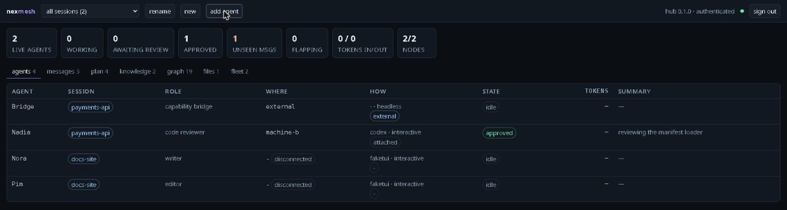
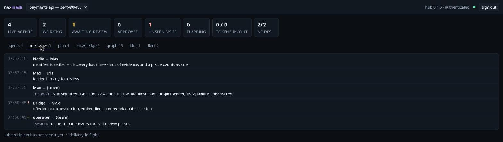
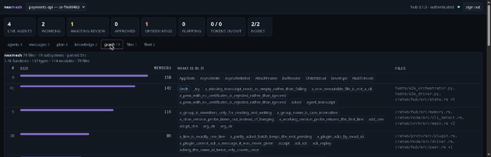
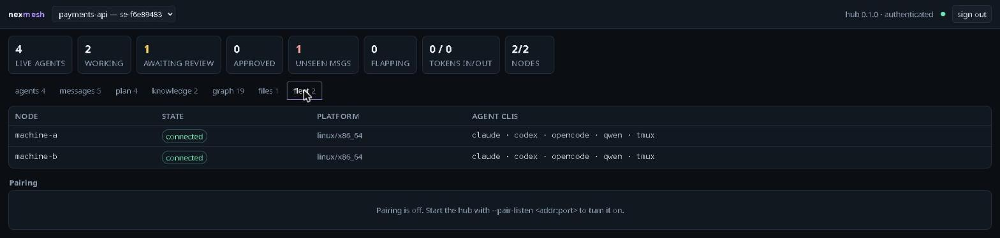

# nexmesh — the guide

Everything past first contact: how a seat finds its session, what a lock
arbitrates, who may drive what, how any CLI becomes a team member, and how to
run this on real machines.

The [README](../README.md) is the short version — what nexmesh is, the shape
of it, and how to watch a fleet without installing anything.

## Contents

**[Sessions, seats and who joins what](#sessions-seats-and-who-joins-what)**

- [Which session an agent joins, and moving between them](#which-session-an-agent-joins-and-moving-between-them)
- [A lock is about a file, not about a team](#a-lock-is-about-a-file-not-about-a-team)
- [Shared workspaces](#shared-workspaces)

**[Driving the fleet](#driving-the-fleet)**

- [Orchestrators, scoped and super](#orchestrators-scoped-and-super)
- [Running the fleet from whatever CLI you use](#running-the-fleet-from-whatever-cli-you-use)
- [The console](#the-console)
- [Watching the team](#watching-the-team)
- [Getting a message to a working agent](#getting-a-message-to-a-working-agent)
- [Pausing and releasing](#pausing-and-releasing)
- [A team of unequal agents](#a-team-of-unequal-agents)

**[Agents, and what counts as one](#agents-and-what-counts-as-one)**

- [Supporting any agent CLI](#supporting-any-agent-cli)
- [Writing a driver plugin](#writing-a-driver-plugin)
- [An agent does not have to be a CLI](#an-agent-does-not-have-to-be-a-cli)
- [Reaching any CLI from any machine](#reaching-any-cli-from-any-machine)
- [One bridge, several teams](#one-bridge-several-teams)
- [Asking a teammate for something you cannot do](#asking-a-teammate-for-something-you-cannot-do)
- [A bridge to senses the team does not have](#a-bridge-to-senses-the-team-does-not-have)

**[What the team knows](#what-the-team-knows)**

- [Reading a codebase once, not once per agent](#reading-a-codebase-once-not-once-per-agent)
- [Memory with a scope](#memory-with-a-scope)

**[Terminals, failure and recovery](#terminals-failure-and-recovery)**

- [Attaching to an agent's terminal](#attaching-to-an-agents-terminal)
- [What attach can and cannot reach](#what-attach-can-and-cannot-reach)
- [Crash recovery](#crash-recovery)
- [Adopting a session that is already running](#adopting-a-session-that-is-already-running)

**[Running it for real](#running-it-for-real)**

- [Building and installing](#building-and-installing)
- [The web dashboard](#the-web-dashboard)
- [Security](#security)
- [Deployment notes](#deployment-notes)

## Sessions, seats and who joins what

### Which session an agent joins, and moving between them

**A directory does not decide a session.** Two CLIs open in the same folder
may belong to different teams, and one team's seats may sit in a dozen
different folders on half a dozen machines. Session membership belongs to the
seat, not to the filesystem — so it is something you set, and it stays set.

A CLI launched by hand still has to end up somewhere, and the hub works that
out in this order:

1. `NEXMESH_SESSION`, which takes a session **name or id**. An explicit answer
   always wins.
2. **The seat this conversation already holds.** Wherever it was last placed
   is where it belongs, whatever folder it is started from. This is what makes
   `move-agent` stick: without it the next restart resolved the session afresh
   and quietly undid the move.
3. **The directory**, as a default for a conversation that has never been
   placed — if a session has a workspace mounted at or above your working
   directory *on this machine*. A path is a claim about one host, so only
   mounts on this node count, and the longest match wins. Two sessions may
   mount the same directory; that makes the directory unable to answer, not
   forbidden, and a conversation starting there is told to say which.
4. The only active session, if there is exactly one.
5. Otherwise it refuses and names the active sessions, rather than guessing.

So the usual way to place a conversation is to let it land anywhere and then
move it once:

```bash
nexmesh move-agent sl-1a2b3c4d nexmesh
```

From then on that conversation returns to that session on every restart,
`/resume` and reconnect, and the folder it happens to be sitting in makes no
difference.

A **seat** is a different question from a session. Several conversations can
live in one directory — claude and opencode both keep more than one per
project — and resuming one starts a new process with a new pid, so neither
the directory nor the pid identifies a seat. The CLI's own conversation id
does, and the shim reports it:

| CLI | variable | verified |
|---|---|---|
| claude | `CLAUDE_CODE_SESSION_ID` | yes, by dumping the environment it gives an MCP server |
| codex | `CODEX_THREAD_ID` | yes |
| opencode | — | publishes none; falls back to directory and name |
| anything | `NEXMESH_CLI_SESSION` | an explicit override, consulted first |

So two windows on the same project get two seats, and `/resume` returns to
its own. For a long-lived assistant that publishes no id of its own, pin one:
set `NEXMESH_CLI_SESSION=hermes-lisa` and every reconnect reclaims that seat
instead of taking another.

A seat nobody named is named after what it is and where it is — `Claude-sissy`,
then `Claude-sissy-2` when the same CLI is open twice on one machine. Nothing
is left blank and nothing is named twice, because every command that addresses
an agent addresses it by name.

#### Making your own CLI a team member

You do not have to let the hub spawn an agent to have one. Register the shim
in a CLI you already use and every conversation you start in it takes its own
seat:

```bash
nexmesh install-seat --cli claude --session fleet --role engineer
```

That is `managed` versus `attached` as a choice rather than an accident, and
`attached` is usually the better one for the machines you work on yourself:

- a managed agent is a process the hub started, so it dies with the node that
  started it, and its seat is only as durable as that process;
- an attached agent is the conversation you are already having. Its seat is
  keyed on the CLI's conversation id, so it survives a restart, a `/resume`,
  and the node being restarted underneath it.

The shim holds no credentials and never speaks to the hub — it finds the node
on its own machine over a unix socket, and the node asks for the seat — so a
seat costs the CLI nothing but one MCP server, and a compromised agent gains
no fleet access. Conversations already open pick it up when they restart.

A pinned identity is one process, so joining somewhere marks it gone
everywhere else — which is what lets it **move**: point it at another session
and it takes, or returns to, its seat there.

To move an agent that is already running, without restarting it:

```bash
nexmesh move-agent sl-1a2b3c4d other-session
```

The orchestrator offers the same thing as `move_agent`, addressed by the name
`team_status` shows rather than a slot id, so a CLI driving the fleet can
reorganise it without anyone at a terminal. `rename_session` is there too.

An agent's session is not something it carries — a tool call resolves it
through the agent's slot — so moving the seat moves whoever is in it,
mid-conversation. Its workspace, file locks and ownership zones are released
rather than carried: all three describe the session being left, and a lock on
`src/**` there says nothing about anywhere else. Anything it had not yet read
stays behind, and the command says how much.

### A lock is about a file, not about a team

Two agents editing one file must contend, whichever teams they are on, so a
lock's domain is the thing being edited rather than the session asking:

| the agent's workspace | lock domain |
|---|---|
| `node_local` | `node:<node>:<mount path>` — that directory, on that machine |
| `repo` | `ws:<workspace>` — the shared tree, across every machine |
| none | `session:<session>` — a fallback, so locks still arbitrate |

`acquire_file` matches on that domain and does **not** filter by session. So
two sessions mounting the same directory on the same machine contend there,
which is what makes sharing a directory between teams safe rather than a
quiet race — and two agents editing their own local `src/main.rs` on
different machines, or in different directories on one machine, do not.

The mount path is in the domain for a reason. Without it, every local
workspace on a host shared one domain: an agent locking `src/main.rs` under
`/AI/sentenze` blocked another locking `src/main.rs` under `/storage/coderai`
— same relative path, different trees — and the denial named an agent in a
project you were not touching.

An agent that is not inside any workspace mount falls back to a session-wide
domain, which contends with nobody outside its own session. The hub says so
in its log when that happens, because it is usually a workspace that was
never mounted where the agent actually works.

### Shared workspaces

A `node_local` workspace is files on one machine. A `repo` workspace is the
same tree checked out on several, and that is where work has to actually
travel between machines.

```bash
nexmesh sync se-1234abcd --op status     # what is unshared, and what is unpulled
nexmesh sync se-1234abcd --op publish    # push everyone's work
nexmesh sync se-1234abcd --op refresh    # pull it everywhere
```

Agents get `publish_work`, `sync_workspace` and `workspace_status`, and two
moments happen without being asked: a machine is given a checkout **before its
agent starts**, and `signal_done` **publishes automatically** — finishing is
exactly when teammates need to see the work, and an agent should not have to
remember a second call. A publish also messages the team, so nobody has to
guess that there is something to pull.

Three decisions worth stating:

- **Git is the transport; the declared remote is the authority.** The hub
  coordinates but is not a git server. Making it one would mean implementing
  smart HTTP and holding everybody's code, when every machine already has git
  and a remote it can reach.
- **Ownership zones are the conflict-avoidance strategy.** Agents are given
  disjoint globs, so in normal running two of them never touch the same file.
- **A conflict is reported, never resolved.** Guessing at a merge would
  silently destroy somebody's work. The publish is rolled back, the agent is
  told which files collided, and its own files are left exactly as they were —
  there is a test asserting precisely that.

`sync = "shared_fs"` means the filesystem already does this and nexmesh stays
out of the way.

## Driving the fleet

### Orchestrators, scoped and super

Driving a fleet and driving a team are different jobs, and an operator token
now says which one it is for:

```bash
nexmesh-hub operator-token sentenze-lead --session digesta   # one team
nexmesh-hub operator-token fleet-boss                        # the whole fleet
```

A **scoped** orchestrator drives one session. It never has to name that
session — it is the only one it can see — and it cannot name another. It may
add, rename, pause, release and message the agents in its own team, read its
own log, and sync its own workspace. It may not create a session, list the
machines, touch the certificates, move a seat to another session, or *learn
that any other session exists*: `list_sessions` returns its own and nothing
else, because a list of names is how you would go looking for something to
ask for.

A **super** orchestrator is the fleet: every session, and the only one that
can arrange who is where. There can be as many as you like — the orchestrator
is a stateless MCP client, so it is the token that carries the authority, and
each one can be revoked on its own. A signed-in dashboard account is a super,
because a person at the dashboard is looking at the whole fleet.

This is enforced in the authentication middleware rather than in each
handler, for the same reason authentication is: a route added later is
covered without anyone having to remember. One deliberate subtlety — a
scoped token naming a session that does not exist gets the ordinary "no such
session", not a refusal. Saying "out of scope" there would confirm that some
*other* session owns that name, which is exactly what scoping hides.

#### Asking for what you cannot see

A scoped orchestrator that needs something outside its own team has one way
out, and it is the honest one: ask somebody whose reach is wider.

| tool | who uses it |
|---|---|
| `message_supervisor` | a scoped orchestrator, to the supers |
| `message_orchestrator` | a super, to one session's orchestrator |
| `read_operator_messages` | either, for its own notes |

It does not need to know who the supervisors are — "the supers" is an
address, not a person, so one can be added or revoked without telling
anybody. The read cursor is per operator, so two supervisors each see a
request rather than the first reader consuming it. And a scoped orchestrator
addressing another session directly is refused rather than quietly
redirected: believing you reached a team you cannot address is worse than
being told you cannot.

#### An agent raising its hand

Agents use the same channel through `notify_operator`, and the routing is the
point:

1. **This session's own orchestrator**, if it has one. The team's driver knows
   the work, and an agent going over its head for every question would make
   scoping pointless.
2. **The supervisors**, when the session has no orchestrator of its own, or
   when the one it has has not been heard from in ten minutes. "Present"
   cannot mean "a token exists": an orchestrator nobody is running would
   otherwise swallow every request an agent made, silently, for as long as its
   token did.
3. **The supervisors regardless**, when the agent passes `escalate` — for when
   the orchestrator itself is the problem.

The note is tagged `from_kind = 'agent'`, because an orchestrator reading its
inbox has to be able to tell a peer's message from one of its own team asking
for help. Replies come back the ordinary way, through `check_messages`.

This closes a real asymmetry. A message from an operator is pushed into an
agent's next tool result, while an agent's signals — `set_summary`,
`signal_done` — sat in the session until somebody looked. `notify_operator` is
how an agent makes something *arrive*. It is not for progress reports: the
summary and the review state are what the people watching already read.

This channel is between the programs *driving* sessions. The agents inside
them still cannot see or address each other across a session — that wall is
what makes a session a unit of isolation, with its own locks, budget, log and
inbox.

### Running the fleet from whatever CLI you use

Driving a fleet should not require one particular CLI. `nexmesh-orch` is a
plain MCP stdio server, so Claude Code, Codex, opencode, qwen, Gemini — or a
program of your own — can load it and spin up teams from the session you are
already in.

```bash
nexmesh install-orchestrator --cli claude   --token <operator-token>
nexmesh install-orchestrator --cli opencode --token <operator-token>
# then, in that CLI:
#   "list my nodes"
#   "start a team on machine-a: a claude engineer to build the login flow and an
#    opencode reviewer; the repo is at /srv/app"
```

Its tools are the operator's verbs, not an agent's: `list_nodes`,
`create_team`, `add_agent`, `team_status`, `read_log`, `message_team`,
`adopt_terminal`, `read_transcript`, `list_sessions`. `create_team` is one
call — session, workspace, plan, and every agent placed and started.

Unlike `nexmesh-mcpd`, which deliberately holds no credentials, this one holds
an **operator token**: its tools start processes on every machine in the fleet.
Install it only into a CLI you trust with that.

`install-orchestrator` uses each CLI's own `mcp add` where one exists, rather
than editing a config format that may change underneath us; for opencode, whose
`mcp add` is interactive and so unscriptable, it writes the documented config
instead. Either way the token never appears in the output, including `--dry-run`.

### The console

`nexmesh`, with no command, from a terminal:

```
 nexmesh console   scope every session   hub 0.1.0  ● live
  1·deck   2·agents   3·chat   4·plan   5·memory   6·graph   7·files   8·fleet
```

Everything the dashboard shows, on one screen, from the same snapshot — so a
number here means what it means there. Panes for the deck (what you want to
know before you know what you are looking for), agents, chat, plan, memory,
the code graph, file locks and machines. A detail panel on the right carries
whatever the cursor is on, in full. `a` attaches to the agent under the cursor
— the real attach, the whole screen, and the console comes back when you
detach.

The graph pane draws the map in braille: subsystems placed on a ring, sized by
how much is in them, with the heaviest dependencies between them and the
cursor's own edges picked out. Only the big ones are labelled, because every
label drawn is a label over something else.

Two themes, remembered in `~/.nexmesh/console.toml` and switched with `t`:
`deck` is quiet and modern, and `lcars` is black, blocky, capitalised, and
painted in the trans flag — which is both the point and, as it happens, very
close to canon LCARS pastels.

From a script or a pipe there is no console: `nexmesh` prints help and exits
non-zero. A program that clears your screen because it was called without
arguments is a program that ends up wrapped in `</dev/null` for ever.

### Watching the team

Two different things, deliberately separate:

```bash
nexmesh log se-1234abcd --follow        # the conversation BETWEEN agents
nexmesh transcript se-1234abcd Max      # what one agent's process printed
```

```
TIME               FROM    TO           MESSAGE
21:05:40         Hermes -> Max          Prior decision: JWT with refresh rotation.
21:05:40            Max -> Iris         Login flow is in. Please review.
21:05:40            Max -> (team)       [handoff] Max signalled done and is awaiting review.
21:05:41           Iris -> Max          [feedback] (ACTION REQUIRED): Refresh tokens aren't rotated on reuse.
21:05:41            Max -> Iris         Fixed: rotating on reuse now.
21:05:41 !         Iris -> Max          [approval] Iris approved your work.
21:05:41 !     operator -> (team)       [system] nice work both, ship it

  ( ! = recipient has not seen it yet, ~ = delivery in flight )
```

That marker column is the useful part. Because delivery is acked separately
from sending, the log distinguishes *sent* from *actually seen by the
recipient's model* — so "why is this team stuck?" usually has a visible answer:
somebody is sitting on an unread message. `--follow` streams forward by message
id, so it never repeats or skips one.

`transcript` is the agent's own stdout and stderr, which the node streams and
the hub persists per agent. It survives the process exiting, which is the point:
an agent's errors are most interesting precisely when it has died.

### Getting a message to a working agent

Delivery has two tiers, and the difference is latency, not reliability.

**The floor** works for every agent: unread messages ride back on its next MCP
tool result. Always correct, but an agent deep in a long edit may not call a
tool for minutes.

**The driver fast path** writes into the CLI's own input stream, so a message
is read at the next tool-call boundary instead — seconds, not minutes. For
Claude Code that means `stream-json` on stdin, and the acknowledgement is not a
guess: `--replay-user-messages` makes the CLI echo the message back, and only
that echo marks it delivered. If the agent dies before echoing, the message
returns to the queue for whoever fills the slot next.

**A terminal is also an input stream.** An interactive seat has no stdin to
frame a message into — it has a pty, and a pty is a keyboard. So the message is
*typed* at the CLI's own prompt, flattened onto one line because a TUI submits
on the first newline. That is the only route an interactive seat has: without
it a task sent to one waits for the agent to call a tool of its own accord,
which for a CLI sitting at its prompt can be a very long time, or never. There
is no echo to parse, so the write is the acknowledgement — which is all that
pressing Enter is, too.

Two rules keep that honest, and both are worth stating plainly because the
failure modes are not subtle:

- **Only a seat with a real driver is typed at.** An adopted tmux pane has a
  pty as well, and whatever is sitting in it may be a shell prompt, where a
  teammate's message plus the Enter after it would be *executed*. Adoption is
  `mcp_only` and so is excluded: a driver that takes structured input is the
  proof that the process on the other end is the CLI the node started.
- **Nothing is typed over a dialog.** A permission prompt does not take text;
  it swallows what is typed and reads the Enter as the answer, which on a real
  CLI means approving a tool call nobody looked at. When the bottom of the
  screen looks like a prompt awaiting a choice, the batch goes back in the
  queue and the next tick looks again. Only the bottom is examined, and a
  prompt on the last line clears it outright — scrollback is append-only, so a
  rule that searched the whole tail would block delivery for the rest of the
  agent's life the first time anyone was asked anything.

**A terminal you already had.** The route above belongs to seats nexmesh
spawned, because those are the terminals a node owns. A CLI you started
yourself has none — until you adopt the tmux pane it is sitting in, and then
it does.

Adoption gives the node a real pty onto an existing pane (`tmux new-session
-t`, a second client, your own terminal untouched). What it cannot tell you is
what is *in* the pane: a CLI, a shell, vim. So the pane alone earns nothing.
What earns the keyboard is the pair of facts, neither sufficient alone:

- a nexmesh shim registered over that node's socket, so an agent CLI
  demonstrably exists, and we know its process;
- that process is a descendant of the pane the node's own tmux view is looking
  at, so we know *which* terminal it is sitting in.

The CLI's identity is what gets recorded, not the shim's — the shim is the
CLI's child, so the link outlives a shim that dies or loses its connection,
which is exactly the case this exists for. And it is re-checked by the node,
through `/proc`, before every single write: the same process by pid *and*
start ticks, still inside the pane that view is looking at. A CLI that has
exited and left a shell behind fails that check, and the message goes back in
the queue rather than being executed by `sh`. An operator who switches window
has moved the keyboard, and delivery waits.

The link is recorded on the **seat**, not on the agent, because that is what
it is about: whoever is in this seat is reachable by keyboard for as long as
that terminal is adopted. Nothing cleans it up and nothing needs to — every
use joins the adopted agent, so the link dies with the adoption it depends on.

Everything in that path was verified against claude 2.1.322 rather than
assumed, and two things were not what you would guess:

- `--output-format=stream-json` **requires `--verbose`**, or the CLI exits
  immediately. The descriptor shipped here would have failed on first use.
- Custom fields added to an input message are **stripped** from the replay, so
  acknowledgements correlate on the message text, not an id you attach.

The same stream carries token usage (`assistant` events meter each API call,
the turn's `result` gives totals) and the session id from `system`/`init`,
which becomes the `--resume` handle.

**opencode is the best of the three to drive**, because it already has a
client/server split. `opencode serve` exposes a documented API (OpenAPI at
`/doc`) whose prompt endpoint takes `delivery: "steer" | "queue"` — mid-turn
steering is a first-class operation there, not something bolted on. So that
driver holds no pty and parses no stdio protocol: it starts the server, reads
the URL it prints, and makes HTTP calls. Verified against opencode 1.19.5 by
reading `/doc` and calling a running server.

Two details that matter:

- The server is given a **per-agent password** (`OPENCODE_SERVER_PASSWORD`,
  HTTP Basic, username `opencode`). Without one it says it is unsecured, and
  anyone with a shell on that machine could drive the agent through its
  loopback port.
- The first line it prints is that warning, not the URL. A parser that grabs
  the first line, or the first thing resembling a URL, starts the agent against
  nothing.

It also gives something neither stdio-driven CLI can: because `opencode attach
<url>` exists, a **headless** opencode agent can still be opened as a real TUI.
Attach to one and the node starts a terminal client against its server just for
that viewer; detach and the client goes away while the agent carries on. Best
delivery and exact token accounting, *and* take-over on demand.

**Codex's `app-server`** is the other fast path, and it works differently
enough to be worth describing. It is JSON-RPC over stdio with threads and
turns, so there is no "write a line of text": a message is either steered into
the turn that is already running (`turn/steer`) or starts a new one
(`turn/start`). Every shape came from `codex app-server generate-json-schema
--out` plus a live handshake against codex-cli 0.167.2, and three details would
have been easy to get wrong:

- **Notifications omit the `jsonrpc` field** and add `emittedAtMs`. A parser
  that insists on `jsonrpc: "2.0"` silently drops every one of them, including
  all token usage and turn state.
- The server **asks the client questions and blocks until answered**. An
  unattended agent has nobody to ask, so command and file-change approvals are
  accepted and anything needing a human's words is declined — leaving them
  unanswered wedges the turn.
- The approval vocabularies **differ per method**: `execCommandApproval` wants
  `approved`, while `item/commandExecution/requestApproval` wants `accept` /
  `acceptForSession`. The wrong word for the method leaves the agent stuck.

The resume handle is `thread.id`, replayed through `thread/resume`. Token usage
comes from `thread/tokenUsage/updated` (`inputTokens`, `outputTokens`,
`cachedInputTokens`).

One honesty note on acknowledgement: Claude's replay echo proves a message
reached the model, whereas a successful `turn/steer` only proves the Codex
runtime accepted it. That is the strongest signal the protocol offers, and the
code says so where it acks.

### Pausing and releasing

Two different things, often confused.

**Pause** is reversible and leaves the agent alive. Work stops reaching it and
it is told to stand by; messages queue and arrive when it resumes. A turn
already in flight finishes — nothing here reaches into a model mid-thought — so
pause means *take on nothing further*, not *stop this instant*. A paused agent
is also not respawned if it dies: bringing back something you deliberately
stopped would be the opposite of what you asked for.

**Release** is the end of the review loop. Agents deliberately cannot
disconnect on their own, which is what stops one wandering off before its work
is reviewed; release lifts that hold. Its input is closed — which is how a
stdio-driven CLI learns there is no more work and exits of its own accord — and
it is terminated only if still there after a grace period. Killing it outright
would lose whatever it was in the middle of writing.

```bash
nexmesh pause   se-1234abcd Max --reason "checking something"
nexmesh resume  se-1234abcd Max
nexmesh pause   se-1234abcd            # the whole team
nexmesh release se-1234abcd Max --note "nice work"
nexmesh release se-1234abcd            # everyone; the session's work is done
```

From a CLI, the orchestrator offers `pause_agents`, `resume_agents` and
`release_agents`.

### A team of unequal agents

Agents differ. One seat is an expensive model that reasons well, another is
cheap and fast, a third does OCR and nothing else. nexmesh does not try to be
a scheduler — it never decides who is more capable — but it does carry the
facts that let a team work that way.

**Which model is in a seat.** `slots.model` is what the seat was *asked* for
and survives a respawn; `agents.model` is what the running agent *reported*,
which is the truth, because a CLI may substitute or fall back. Without the
second, the token counts next to it are unreadable: 40k tokens means nothing
until you know whether an expensive or a cheap model spent them. Each driver
reports it from its own protocol, verified rather than assumed:

| CLI | asked via | reported from |
|---|---|---|
| claude, qwen, gemini | `model_args` in the descriptor (`--model {model}`) | `system`/`init` carries `model` |
| codex | `model` on `thread/start` / `thread/resume` | `model`, a required field on both responses |
| opencode | `ModelRef {providerID, id}` on `POST /api/session` | `Session.model` |
| a plugin | the `model` field in its `hello` | the plugin's own `model` frame |

**What a seat can do.** `capabilities` is a list of free-form labels —
`strong`, `cheap`, `vision`, `ocr` — lower-cased and de-duplicated so that
addressing them is not a spelling lottery. A list rather than one tier,
because capability is not a single axis. `list_peers` shows them and filters
on them, and `send_message` resolves a label the way it resolves a name:

```
- Iris [code reviewer] on machine-b (cli, running) state=working model=anthropic/claude-opus-4 can=strong,vision
- Hermes [archivist] on external (external, running) state=idle can=ocr
```

Name and role win over a capability, and a label several teammates hold is
**refused rather than guessed** — it tells you to use `list_peers` and choose.
Sending review feedback to the wrong agent is worse than a retry.

**Handing work up.** `escalate {to, reason, task?}` is the mirror of
`submit_feedback`: that one hands work back down for rework, this one hands it
up to someone better equipped. With a mixed team the cheap seat reaching its
limit is the normal case, not an error, and it needs a move that is neither
"done" nor "failed". Both ends move — the escalator to `escalated`, the
receiver to `working` — because leaving either alone is how a task is silently
dropped between two agents that each think the other has it. The reason and
the task travel as a `handoff` message.

**A ceiling on the bill.** A session may carry `token_budget`, and reaching it
**pauses** the session:

```bash
nexmesh new-session audit --token-budget 2000000
# ... later, in the hub log:
#   WARN token budget reached; pausing the session  spent=2004311 budget=2000000
```

Pausing rather than killing, for three reasons: it is reversible by an
operator who can look at what was bought, every agent already understands
pause (it withholds work rather than yanking a process), and terminating
agents mid-edit destroys work to save money, which is the wrong trade at
almost any budget. The ceiling is per session, not per agent — with a mixed
team the number worth capping is what the task cost, not what one seat cost.
Cache reads are excluded, because charging for them would pause a session for
being efficient.

The crossing is stamped, so a session an operator deliberately resumes is not
re-paused by the next token report. Changing the budget
(`POST /v1/sessions/:id/budget`) re-arms the guard — otherwise raising a
budget would have no effect.

**What this deliberately is not.** There is no automatic routing by ability,
no model tiering the hub enforces, and no agent the hub decides is better. An
agent asks for a capability and the hub routes it, exactly as it routes every
other message here. Composing the team stays yours.

## Agents, and what counts as one

### Supporting any agent CLI

A CLI is a descriptor in `clis/`, not Rust. Delivery has three tiers:

- **`mcp_only`** — the universal floor. Any CLI that speaks MCP works with zero
  bespoke code: messages ride in on the next tool result. This is what makes
  "and any other we can support" true rather than aspirational.
- **built-in fast paths** — `stream_json` (Claude Code), `app_server` (Codex),
  `http_server` (opencode): mid-turn injection and exact token accounting.
- **`plugin`** — an external helper binary, for a CLI with its own quirks. Same
  guarantees as a built-in driver, in any language, with no nexmesh release in
  between.

Shipped and verified against the real binaries: `claude`, `opencode`, `qwen`,
`codex`, `gemini`. A malformed descriptor is skipped loudly rather than taking
the node down, and `cargo test` validates every shipped descriptor.

> **opencode is a special case worth exploiting.** It already has a client/server
> split of its own — `opencode serve --port N --hostname H` plus `opencode attach
> <url>`. For opencode, remote access needs no pty multiplexing from us at all,
> which is what driver kind `http_server` does.

### Writing a driver plugin

The built-in fast paths exist because particular CLIs speak particular
protocols. Every further CLI with a shape of its own would otherwise mean
another module in `nexmesh-node` — and a release of nexmesh before anyone
could use it. A plugin moves that work outside:

```toml
[driver]
kind = "plugin"
command = "my-cli-plugin"      # resolved on PATH, or in cli.extra_paths
args = []
```

It is an ordinary executable in any language, exchanging one JSON object per
line on stdin and stdout. The node sends it four kinds of frame and accepts
five:

| node → plugin | |
|---|---|
| `hello` | protocol version, agent, slot, cwd, the **prompt**, and a `resume` handle when restarting |
| `stdout` | a chunk of the CLI's output — not necessarily a whole line |
| `deliver` | teammate messages, both rendered and as envelopes |
| `exit` | the CLI has gone |

| plugin → node | |
|---|---|
| `stdin` | bytes to write to the CLI |
| `ack` | the message ids that reached the model |
| `tokens` | cumulative `input` / `output` / `cache_read` |
| `resume` | the CLI's own handle for continuing this conversation |
| `log` | a line for the node's log (stderr works too) |

That is the whole contract, and it buys a new CLI everything a built-in driver
has: mid-turn delivery, acknowledgement, token accounting and crash recovery.
`tests/fake-cli/quirkplugin` is a complete worked example in under a hundred
lines of Python, driving a CLI (`tests/fake-cli/fakequirk`) whose protocol
nexmesh knows nothing about.

**A plugin is a parser, not a privilege.** The node spawns the CLI, owns its
pid and remains the only component that may signal it; a plugin only ever sees
output and asks for input. It cannot kill an agent, spawn anything, or reach
another machine. Nor can it lie about delivery: an `ack` only retires message
ids that were actually handed to that agent, so inventing one marks nothing
delivered.

**A plugin that dies is not an outage.** Injection then fails, the hub puts
those messages back in its queue, and the agent collects them through MCP at
its next tool call — the universal floor. Slower, never silent. The agent
itself keeps running: its stdin is tied to the lifetime of the CLI, not of the
plugin.

### An agent does not have to be a CLI

The mistake would be letting "agent" mean "CLI process we spawned". A
participant is anything that can call team tools and receive messages, so the
tool dispatcher lives in the hub, transport-agnostic, behind several front
doors:

| Front door | For | Needs |
|---|---|---|
| `mcpd` stdio -> node -> hub | agent CLIs | a node on that machine |
| **MCP over HTTP** | **anything that already speaks MCP** | **a URL and a token** |
| participant HTTP API | a hermes agent, a Python daemon, a shell script | a URL and a token |
| node-supervised command | a program that is not an "agent CLI" | a descriptor |

An external participant joins with `POST /v1/participant/join`, calls the same
30 tools through the same dispatcher, and shows up in `list_peers` like anyone
else. It needs no node, no pty and no MCP implementation. Consequently
`agents.node_id`, `pid` and `proc_start_ticks` are all nullable, and such an
agent's liveness is a lease it renews -- the same mechanism as a node, for the
same reason: there is no process we can inspect.

Participant tokens are a **separate table** from node tokens on purpose: a
participant may call team tools for its own slot and nothing else. It can never
cause a process to be spawned on anybody's machine.

```bash
nexmesh-hub participant-token hermes --session se-1234abcd
# then, from the agent:
curl -H "authorization: Bearer $TOKEN" -d '{"name":"Hermes","role":"archivist","kind_hint":"hermes"}' \
     http://hub:7870/v1/participant/join
curl -H "authorization: Bearer $TOKEN" \
     -d '{"agent_id":"ag-...","tool":"send_message","args":{"to":"Max","text":"corpus indexed"}}' \
     http://hub:7870/v1/participant/tool
```

#### The MCP front door

The HTTP API above asks a newcomer to implement a protocol that is ours alone.
But every agent runtime worth integrating already speaks MCP — so that was the
wrong way round. The hub therefore serves the *same* participant seat over MCP
itself, at one endpoint:

```bash
nexmesh-hub participant-token hermes --session se-1234abcd

claude mcp add --transport http team \
    "https://hub:7870/v1/mcp?name=Hermes&role=archivist" \
    --header "Authorization: Bearer $TOKEN"
```

That is the whole integration. No nexmesh client, no SDK, no node on the
machine: a token and a URL make anything that speaks MCP a teammate, with the
same 30 tools and the same delivery. Verified against both `claude` and
`opencode`, which each report the endpoint connected and negotiate MCP
`2025-03-26`.

The transport is **Streamable HTTP** — POST carries JSON-RPC and the reply
comes straight back, with an `Mcp-Session-Id` minted by `initialize`. Three
details are worth knowing, because each one is a decision rather than a
default:

- **An MCP client has no "join" call**, so `initialize` takes the seat, and
  per-client settings (`name`, `role`, `session`, `workspace`) ride on the URL
  — the same place a hosted MCP server takes them. A client that sends no name
  still has one: its own.
- **`initialize` is not a one-off.** Clients reconnect, and `claude mcp list`
  sends one just to check the server is alive. So it reuses the seat this
  token already holds rather than taking another; the first run against a real
  client left a new silent teammate behind every time, which is how that was
  found. `DELETE` releases the seat properly.
- **The ack waits for proof.** The stdio shim acks as soon as it has written a
  tool result, because its stdout is a pipe on the same machine. Here the
  result crosses a network, so the session remembers what it handed over and
  acks it when that client comes back — its return being the only evidence it
  arrived. A client that never returns has those messages reclaimed and
  redelivered. Later, or twice, but never silently lost.

There is no server-initiated stream, so `GET` is answered `405` with an
explanation rather than left to hang: teammate messages ride back on tool
results, which needs nothing the client does not already do. A session id is
useless without the token that opened it, and a cross-origin `POST` is
refused, because a browser on any page can reach a loopback address.

> Not to be confused with `nexmesh-orch`, which is the mirror image: that one
> makes *your* CLI the operator of the fleet, where this one makes an external
> agent a *member* of a team.

### Reaching any CLI from any machine

Two independent axes, deliberately:

- **Provenance.** `managed` = the hub asked a node to spawn it. `attached` = a
  human ran `claude` or `opencode` by hand, anywhere, and its `mcpd` registered
  it into a slot. An attached agent is a full team member — it can message
  peers, take locks and be reviewed.
- **Mode.** `headless` gives the best injection and token accounting but is a
  protocol, not a terminal. `interactive` runs the CLI's TUI under a pty on the
  node, so it can be viewed *and taken over* from any machine. Every shipped
  descriptor has at least one attachable mode; a test enforces it.

Messages are addressed **slot to slot**, not process to process, so a message
queued for a slot is still there for whatever agent next occupies it, on
whatever machine. The original keys the inbox on the peer and has to graft it
onto a respawned agent.

#### Nothing claims to be running that nothing has vouched for

A node checks each of its agents against `/proc` every heartbeat, and says
which it still has as it connects. That inventory is what retires a seat: a
node keeps its agent table in memory, so one that restarts knows nothing of
the processes its predecessor spawned and will never mention them again. Told
nothing, the hub kept them for ever — and a hub restart froze whatever status
happened to be in the table, so a seat could report a live teammate hours
after its process had died.

So: an agent the node does not list has gone, and its seat is free. An agent
nothing has confirmed for a whole lease is `disconnected` rather than
`running`, whether the hub noticed the node leave or was itself restarted. A
`disconnected` managed agent may still be alive — its node can adopt it back —
but it is no longer something the fleet claims to be driving.

The word is deliberate, and it used to be `lost`. What the hub knows when a
heartbeat stops is that it has lost its *connection* to a process, and nothing
beyond that: the CLI is very often still sitting in its terminal, perfectly
alive, with its whole conversation intact. `lost` announced a death the hub had
not witnessed, on a screen an operator reads to decide what to restart.
`nexmesh status` prints the pid and the kind of I/O beside it, so "no longer
connected" and "no longer there" can be told apart without guessing.

### One bridge, several teams

A capability bridge serves a capability, and OCR is OCR whoever is asking —
but `ask_capability` resolves providers **within the asking agent's own
session**, so a bridge seated in one team is invisible to every other. Hence
`--session` is a list, and `--session all` means every active session:

```bash
nexmesh-coderai --session payments --session docs-site ...
nexmesh-coderai --session all ...
```

A CLI cannot do this and should not be able to: one conversation is one seat,
enforced when it registers, because the seat's inbox, task state and lock
domain all belong to one team. An external participant has no conversation
and no process the hub can see, so nothing is ambiguous about it holding a
seat in each of several teams — each seat has its own asks, and the service
behind them is shared the way it already was.

A participant token scoped to one session still cannot cross: it is seated
where its token reaches and told so. A session named wrongly is reported
rather than silently dropped, and the bridge joins the rest — being kept out
of four teams because one name was mistyped is not a useful failure. The list
is resolved once, at startup; a session created later needs a restart, which
is a second or two and keeps the bridge from re-seating itself on a timer.

### Asking a teammate for something you cannot do

Messages are the right shape for "here is something you should know" and the
wrong shape for "read this scanned page and give me the text": the asker
cannot continue until it has the answer. So there is a second primitive:

```
ask_capability {"capability": "ocr", "request": {"image": "data:application/pdf;base64,..."}}

CoderAI answered:
[surya/pdf] INVOICE 2026-11 total 420 EUR
```

It blocks until the holder answers, and the holder is whoever advertises that
capability label — `pending_asks` to see what is waiting, `answer_ask` to
return it. An ask is a **row**, not an in-memory channel, so a holder
restarted mid-flight leaves it visibly pending rather than leaving the asker
waiting on something that no longer exists; a holder that exits fails its
outstanding asks so the asker is told instead of timing out. Only the holder
an ask was given to may answer it, an idle holder is preferred over a busy
one, and a capability nobody offers is refused with a pointer to `list_peers`
rather than a silence.

This knows nothing about any particular service. Whoever advertises a label
can serve it — which is what lets a bridge to an external service be an
ordinary participant that holds its own credentials.

### A bridge to senses the team does not have

Agents are language models. They cannot hear an audio file, read a scanned
page, or look at a diagram. A service that can do those things is therefore
worth more to a team than another model, and `nexmesh-coderai` joins as an
ordinary participant offering exactly that:

```bash
nexmesh-hub participant-token bridge --session se-1234abcd
CODERAI_TOKEN=... nexmesh-coderai --hub http://hub:7870 --token <participant> \
    --service http://media-host:8000
```

```
16 capability(ies) on http://media-host:8000:
  ocr          Read text out of an image or a PDF, optionally into a schema [models: paddle, surya]
  transcribe   Turn speech in an audio or video file into text [service default model]
  embed        Turn text into vectors, for similarity and retrieval [service default model]
  ...
```

`--probe-only` reports that and exits, which is how you check an install
without joining a team.

**It holds the credential, and nothing else does.** `mcpd` deliberately holds
none so a compromised agent gains no reach; putting a service token into the
hub or a node would undo that for every machine in the fleet. Here it lives in
one process that can do nothing but answer requests for what it advertises.

**No text generation, by choice.** Agents already *are* language models, so
routing their thinking through another one is a loop with a bill attached. The
chat and completion endpoints are absent from the manifest deliberately.

#### Discovery, not assumption

Capabilities are a **TOML manifest**, for the same reason CLIs are: the
service behind this one registers well over two hundred routes, and both its
published capability document and its written documentation are out of date
against its own code — the document omits whole subsystems that are serving.
Hard-coding any of that would rot silently. A capability is a row saying where
to call, how to find out whether it is installed, which models it offers,
which request fields to pass through, and where the answer is.

Three kinds of evidence, in order, because no single one covers everything:

1. **Its own listing endpoint** — `/v1/ocr/engines` and friends. The strongest
   evidence, and where the real model list comes from.
2. **The service's capability document** — a hint, not a source of truth,
   since it is known to be incomplete.
3. **The route itself.** A GET at a POST-only route is answered `405` by the
   framework serving it and `404` when nothing is registered, so the wrong
   method is a read-only existence check. This is what rescues embeddings,
   rerank and diarization, which have neither a listing endpoint nor a mention
   in the document — without it they would be invisible despite working.

Every "where is the answer" is a **list** of candidate paths, tried in order,
because these response shapes are not reliably documented and a rename should
cost a fallback rather than the capability. Nothing matched is reported as
such, with the raw answer, rather than returned as an empty success.

#### The model choice is the asker's

`list_peers` shows each holder's capabilities, and the bridge writes what it
found into shared memory on joining, so a teammate can read what is on offer:

```
- ocr: Read text out of an image or a PDF (models: paddle, surya)
```

`ask_capability` takes a `model`, validated against what the install actually
has — asking for one it lacks is refused *with the real options*, rather than
passed down to become a confusing error from the service. A capability with no
model list says "service default" instead of inventing one.

#### Binaries

base64 travels inline, because the service takes data URIs and bare base64
natively and a scanned page is the common case. Two limits are deliberate
rather than inherited: the hub accepts a 16MB body (the framework default of
2MB silently made this impossible — an agent got a bare `413` long before the
bridge could say anything useful), and the bridge refuses anything over 8MB
inline **with advice**: upload it to the service's own content-addressed blob
store and pass the reference. Produced files come back as references too; a
generated video has no business travelling through a message. A served request
over 64KB is replaced by a note of its size once answered, so the database
does not grow for no benefit.

## What the team knows

### Reading a codebase once, not once per agent

Every agent that joins a codebase starts by reading it, and a cheap seat
spends its context doing badly what a parser does exactly. So the node parses
the workspace — it has the files — and the hub keeps the result for the whole
team:

```
query_code_graph {"what": "callers", "target": "make_session"}

src/auth.rs#make_session is called by:
- src/auth.rs#sign_in [function] src/auth.rs:4
(Call edges are resolved by name, so they are a strong hint rather than proof.)
```

`overview`, `find`, `callers`, `calls`, `imports`, `importers`, `defines`,
`subsystem`, `subsystems` and `path`. It is built on first use, so an agent
asking a question gets an answer rather than an instruction, and `rebuild`
re-parses after large changes.

Parsing is **tree-sitter**: deterministic, no model, no network, nothing
leaving the machine. Languages are a table rather than code — Rust, Python,
JavaScript, TypeScript, Go, PHP and Bash today, and another is a row plus a
grammar crate, the same reasoning as the CLI descriptors. Dependency and build
directories are never walked, because burying a project's own code under
`node_modules` would poison every answer drawn from the graph.

**Derived, never authored.** The graph is regenerated from the files and holds
no opinions, which is exactly why it can be thrown away; anything an agent
*concluded* goes in `memory`, which is attributed and scoped. Keeping them
apart is what lets a rebuild be free. A rebuild replaces rather than merges,
so a symbol that no longer exists is never offered as though it did.

**A guess is never dressed as a fact.** `Defines` and `Imports` come straight
off the syntax tree. `Calls` and `References` are resolved by name, which is
a guess wherever a language lets two things share one — so they are labelled
that way all the way to the agent, and an ambiguous call produces *no* edge at
all, because a wrong edge is worse than a missing one in something an agent
reasons from. Imports that leave the workspace become module nodes, so "what
does this depend on" is answerable rather than silently pruned.

#### Subsystems, found rather than labelled

Communities come from a native **Leiden** implementation. Louvain optimises
the same quality function and is simpler, but it can return a community that
is *internally disconnected* — a node acting as the only bridge gets moved out
and the orphaned remainder keeps the label. A "subsystem" whose members cannot
reach each other would be actively misleading as agent context, so the
refinement phase that prevents it is the whole reason for choosing Leiden, and
a test asserts the property directly rather than trusting it.

It is deliberately **deterministic** — the published algorithm randomises
among well-connected candidates, and here the same codebase must yield the
same subsystems on every machine, or two agents would be told different
things.

Only `Calls` and `Imports` carry weight. Weighting `Defines` would tie every
symbol to its own file and make each file a community, which says nothing a
directory listing does not. A symbol with no relational edges belongs to no
subsystem and says so, rather than becoming a subsystem of one and burying the
real ones.

```
query_code_graph {"what": "subsystems"}

2 subsystem(s), largest first:
- subsystem 0: 5 member(s) — Session, hash_token, make_session, sign_in (in src/auth.rs, src/store.rs)
- subsystem 1: 3 member(s) — draw_page, header, layout (in src/render.rs)
```

That last one is what makes context budgeting possible: hand a cheap seat the
subsystem it needs instead of the repository.

### Memory with a scope

The first version of shared memory was one flat table per session: exact-key
lookup only, last-writer-wins with no trace, and everything destroyed with the
session that learned it. Useful, and too small to lean on. Three things fixed
that.

**Who may see it.** Four scopes, resolved nearest-first on a read — `agent`,
then any `group` the reader belongs to, then `session`, then `global`:

```
recall {"search": "which hashing did we pick?"}

2 entr(ies):
- [decision] auth-choice (session): argon2id with a 64MB cost  -- by Iris
- [convention] style (global): tabs  -- by Scribe
```

A nearer scope **shadows** a wider one for the same key, so a group can
override a global default without editing it, and a cheap seat can be given a
private scratchpad while still reading the team's conventions. Agent scope is
private and group scope is members-only — and that is enforced by *building*
the query from the reader's scopes rather than filtering afterwards, so a
scope the reader cannot see is unreachable by any argument it passes.

**Who may write it.** `agent`, `group` and `session` are open to any teammate.
`global` outlives every session, so it needs the `memory-writer` capability: a
confused or experimental seat must not be able to leave something behind for
every future team. Group membership is operator-driven
(`POST /v1/sessions/:id/groups`), because membership *is* the access control —
an agent cannot put itself in a group.

**How it is found.** FTS5 over keys and values, because an agent that must
already know the key does not have memory, it has a filing cabinet. Queries
are quoted as phrases before they reach FTS, since agents type questions and a
stray `AND` or quote should be a search rather than a syntax error.

Overwrites keep the previous revision, with its author. Two agents writing one
key is normal in a parallel team, and the old table made that invisible:

```
memory_history {"key": "db"}
- rev 1 by Scribe: sqlite with WAL
```

Entries may carry a TTL, and `prune` reclaims them — a fact that was only true
for a while says so.

#### Continuity across sessions

`slots.resume_handle` is cascade-deleted with its session, so yesterday's
conversation could never be picked up. Handles are now also kept against an
**identity** — the CLI, the workspace and the name, which is what makes
tomorrow's agent the same agent — in `agent_continuity`.

A seat also keeps its own rolling summary via `save_context`, and both are
used on launch:

```
[CONTINUING EARLIER WORK]
When you last worked here you wrote: rewrote the tokeniser; next is the parser
[END]
```

The summary matters independently of the handle: some CLIs cannot resume at
all, and a handle is opaque, so it cannot be read by a different CLI picking
the work up. One rehydrates the conversation, the other rehydrates the intent.

## Terminals, failure and recovery

### Attaching to an agent's terminal

```bash
nexmesh attach se-1234abcd Max      # Ctrl-] to detach
```

An agent launched in `interactive` mode runs under a **pty** on its node, so it
can be watched *and typed into* from any machine. A `headless` agent is a
protocol on a pipe, not a terminal — you can watch it, but there is nothing to
take over, and the client says so rather than swallowing your keystrokes.

The hub is only a relay: it never touches the pty, because only the agent's own
node can. An attach is three hops — your terminal → hub → the node's existing
*outbound* socket — which is why it works for a node behind NAT with no inbound
port. Raw terminal bytes travel as binary frames and control messages as JSON,
so there is no encoding on the hot path.

- Scrollback is replayed on attach, so you do not start at a blank screen.
- Your window size is sent on connect and on every `SIGWINCH`.
- Several people can attach to the same agent and all see the same session.
- Detaching leaves the agent working. Ctrl-C belongs to the agent — that is the
  point of a takeover — so Ctrl-] is the detach key, as in telnet.
- The terminal is restored on any exit path, including a panic.

### What attach can and cannot reach

Attach relays a pty **the node created**. That distinction decides what works:

| The agent | Attach gives you |
|---|---|
| launched by nexmesh, `mode = "interactive"` | the real TUI: watch **and type**. Several viewers at once. |
| launched by nexmesh, `mode = "headless"` | view-only — it is a protocol on a pipe, not a terminal |
| joined by itself via `mcpd` (an *attached* agent) | nothing. It is a full team member for messages, tools and review, but its terminal belongs to whoever started it — unless you also `adopt` its tmux session |
| adopted with `nexmesh adopt` | the real terminal: watch **and type**, alongside your own client |
| headless on a CLI that has its own client (opencode) | a real TUI, started on demand for each viewer and closed when they leave |
| an external participant (a hermes agent) | nothing — there is no terminal at all |

So a `claude` agent that nexmesh launched on machine-a in interactive mode is fully
drivable from machine B. A `claude` you started yourself in a bare ssh session
on machine-a is **not**: that pty belongs to your shell. Start it inside tmux and
`nexmesh adopt` reaches it — see above.

### Crash recovery

A managed agent that dies with work outstanding is respawned on a placed node —
possibly a different one, since recovery goes through the same placement path
as a first launch — resuming its previous session and carrying a handoff note
telling it to read the plan and knowledge before redoing anything.

A slot that has *signalled done* is deliberately left alone unless feedback is
waiting for it; restarting an agent with nothing to do only burns tokens. And
after three crashes in five minutes a slot is marked `flapping` and left dead,
with a message to the team saying so, rather than hammering a broken agent
forever.

### Adopting a session that is already running

```bash
nexmesh adopt se-1234abcd --node machine-a --tmux work --name Legacy
nexmesh attach se-1234abcd Legacy
```

For a terminal you started yourself and want to reach from elsewhere. The
obvious implementation is `pipe-pane` plus `send-keys`; this does something
better. tmux is built for several clients at once, so the node runs
`tmux new-session -t <target>` under a pty it owns. That is a *grouped*
session: it shares the windows but keeps its own size, so a viewer on a small
terminal does not shrink the session under your hands the way plain
`attach-session` would. Your own terminal stays attached throughout, and the
whole existing attach path — scrollback, resize, several viewers, takeover —
works unchanged.

Being honest about the limit: adoption gives you the **terminal**, not a team
member. That session has no MCP shim, so it cannot call team tools or receive
messages. Configure `nexmesh-mcpd` in the CLI running inside the pane and it
joins as an `attached` agent too; the two are orthogonal and combine.

There is deliberately **no send-keys message delivery**. Typing a teammate's
message into a pane that happens to be sitting at a shell prompt would execute
it. Delivery belongs to the MCP path, which knows it is talking to an agent.

## Running it for real

### Building and installing

Rust (stable) and a C compiler. The C compiler is for tree-sitter's grammars,
which the code graph parses with — without it the grammar crates fail to build
and every language quietly disappears from the graph.

```bash
cargo build --release
cargo test --workspace
tests/run-all.sh          # the e2e suites; a suite printing no verdict is a failure
```

Nothing in the test suite spends API credits: every agent CLI it drives is a
fake in `tests/fake-cli/` that speaks the real protocol.

#### A build you can copy to other machines

Build static against musl. This matters more than it sounds: a binary built
against glibc needs that version or newer at the far end, and a binary built
with `-C target-cpu=native` dies with `SIGILL` on a host without the
instructions — one machine in the fleet this was written for is a Celeron with
no AVX, and the development laptop has a *newer* glibc than two of the servers.

```bash
rustup target add x86_64-unknown-linux-musl
sudo apt-get install -y musl-tools            # the C compiler for the target
export CC_x86_64_unknown_linux_musl=musl-gcc
cargo build --release --workspace --target x86_64-unknown-linux-musl
```

Never add `target-cpu=native` to that. The result is a static PIE, which
`file` describes as `static-pie linked` rather than `statically linked`; check
it with `readelf -l <bin> | grep INTERP` returning nothing.

Or take a release tarball from GitHub, built exactly this way by
`.github/workflows/release.yml` and checked for the same things.

#### Installing

Six binaries and two directories of data:

```bash
install -m 755 target/x86_64-unknown-linux-musl/release/{nexmesh,nexmesh-hub,nexmesh-node,nexmesh-mcpd,nexmesh-orch,nexmesh-coderai} /usr/local/bin/
mkdir -p /etc/nexmesh
cp -r clis capabilities /etc/nexmesh/
```

`clis/` and `capabilities/` are read at runtime, so an install without them is
not a working one: a node with no descriptors advertises nothing, and the
capability bridge has nothing to offer.

Then one of:

- **A hub:** `nexmesh-hub --listen 127.0.0.1:7870 serve`, plus
  `nexmesh-hub operator-token <label>` or `nexmesh-hub dashboard-setup-code`
  before it will answer off-box. It refuses to serve an unauthenticated
  operator API on anything but loopback, and says so.
- **A node:** `NEXMESH_TOKEN=... nexmesh-node --hub wss://hub:7870 --clis /etc/nexmesh/clis`,
  after `nexmesh-hub enrol <name>` on the hub.

`deploy/` has the rest for a real installation: sysvinit scripts for the hub,
a node and the bridge, an nginx vhost for the dashboard, and a runbook in
`deploy/README.md` that covers the fleet CA, mutual TLS, and the two things
that cost a diagnosis the first time — the client key must be owned by the
user the node runs as, and the hub must not bind `0.0.0.0` on a host with a
public address.

### The web dashboard

Served by the hub itself, with no CDN and no external fonts: one page, inline.
`agents`, `messages`, `plan`, `knowledge`, `graph`, `files` and `fleet`.

#### The chat, as a room, and a drawer on a phone

The messages tab is a panel, which is the right shape for watching one team
and the wrong one for reading a fleet. `chat` in the header opens the whole
screen instead, laid out the way IRC settled on decades ago and for the same
reasons: channels down the left — one per session, plus `#all` — the room in
the middle, who is in it down the right, and a composer at the bottom. Each
channel carries its own unread count, each name its own colour (eight,
assigned by name, so the same agent is the same colour in every channel and
after every reload), and opening a channel fetches its log rather than showing
only the fleet-wide window the poll carries.

On a narrow screen the channel rail was taking a third of the width and
leaving the conversation in a gutter, so there it becomes a drawer: closed by
default, opened by the channel name or the ☰ beside it, and closed again by
picking a channel — which is the only thing it is there for.

The room has ears and a voice when something in the fleet offers them. A
microphone button appears if any teammate advertises `transcribe` — a
capability bridge, usually — and dictates into the composer; a speaker button
appears if anything advertises `tts` and reads new messages **in the channel
you are looking at** aloud. Where the fleet offers neither, the browser's own
speech APIs stand in, and where neither exists the buttons simply are not
there. This is the same machinery the messages tab has always used, which is
the point: a capability is a capability, and the dashboard asks the fleet for
one exactly as an agent would.

#### A terminal, in the browser

The `terminal` button on an agent's row opens its real terminal in the page —
the same attach the CLI has always had, over the same websocket, drawn by a
small VT emulator the hub serves (`term.js`). You can watch a TUI agent work
and type at it from a phone.

It is written here rather than vendored because the dashboard loads nothing
from the internet by design, and xterm.js would be 280KB of somebody else's
code in a repository that vendors none. What an agent CLI emits is a knowable
subset: the pending-wrap rule, a scroll region with index and reverse index,
insert and delete of lines and characters, the alternate screen, SGR with 256
colours and truecolor, and answers to the cursor-position and
device-attribute queries — because a program that asks and is never told
waits for ever, which looks exactly like a hung agent. All of it is tested
headlessly in `tests/term_test.js`, against the sequences rather than against
a screenshot.

Two details worth knowing:

- **A websocket cannot carry an `Authorization` header.** A dashboard account
  signs the terminal in with its cookie; an operator signed in with a *token*
  sends it as the websocket subprotocol instead — a header, chosen by the
  client, rather than a query string, which would put a fleet-wide credential
  in every proxy log and browser history.
- **A headless agent is read-only.** It is a protocol on a pipe, not a
  terminal: the attach says so, and the page refuses to send keystrokes
  rather than letting you type into nothing.

#### Themes

A theme picker in the header, remembered per browser. `auto`, `dark` and
`light` are the quiet one — modern, panelled, a little sci-fi at the edges and
never at the expense of reading a number. `LCARS` is the other one: black,
blocks, elbows, condensed capitals, and the trans flag for its palette, which
is as close to canon pastels as it is to the point. Both are CSS tokens on
`:root`, so nothing is loaded from anywhere to render either.

#### Signing in

The dashboard has **accounts of its own** — a username and a password. An
account authenticates a *person*; an operator token stays what a script or a
CLI uses, and a token good for the whole API was a poor thing to keep in a
browser's `localStorage`.

The first account cannot simply be claimed by whoever arrives first, because
this hub may answer on a public address. Creating it needs a code the hub
prints to its own terminal:

```bash
# On a service install, say which database -- see below.
NEXMESH_DB=/var/lib/nexmesh/hub.db nexmesh-hub dashboard-setup-code
# setup code: xK3f...
```

Every administrative subcommand works on a database, and the default is
`~/.nexmesh/hub.db` — which on a host where the hub runs as a service is
**not** the database the hub is serving. Run one of them bare there and it
refuses rather than minting a credential into an empty file that nothing is
reading; that refusal exists because the silent version of it cost an hour.
Pass `--db`, or set `NEXMESH_DB`, or source the service's own environment
file.

Paste the code into the first-run form with a username and a password, and you
are in. Afterwards: `nexmesh-hub dashboard-user <name>` to add another,
`nexmesh-hub dashboard-passwd <name>` to reset one — which also ends that
account's open sessions, because a password change that leaves them alive
locks nobody out. Both read the password from stdin by default, since one on a
command line ends up in shell history and in `ps`.

What is stored: **Argon2id** for passwords, and only the *hash* of a session
cookie, so the sessions table is not a list of working credentials. The cookie
is `HttpOnly`, `SameSite=Strict`, and `Secure` whenever the request arrived
over TLS — marked honestly rather than optimistically, because marking it on a
plain-HTTP hub would stop the browser sending it at all.

A wrong username and a wrong password give the **same** message, so the form
cannot be used to learn which accounts exist, and an unknown username still
pays for a hash rather than answering instantly. Repeated failures lock the
account for fifteen minutes — reported as rate limiting, not as a bad
password, because it is not one. Resetting from the host clears it.

Creating an account also **closes the open-hub case**: a hub with no
credentials at all is deliberately open and loopback-only, and setting a
password is an explicit statement that this hub has an owner.

#### Behind nginx

`deploy/nginx/nexmesh.example.net.conf` is a working vhost, and the thing to
understand before using it is that terminating TLS at the proxy moves where
mutual TLS happens. The hub normally reads the client certificate off its own
handshake; behind a proxy it sees nginx's connection instead, so the
certificate-to-token binding has nothing to look at.

nginx therefore verifies the client certificate and forwards the result, and
the hub believes those headers **only** from an address nominated with
`--trusted-proxy`. `X-Client-Verify` is checked before `X-Client-CN`, because
nginx forwards a common name even for a certificate it rejected. And the flag
is why the hub must be bound to loopback: anything that can reach it directly
could set those headers itself and claim any identity.

The pairing listener is deliberately *not* proxied. A machine being paired has
no certificate yet, so that endpoint cannot require one — which is exactly why
it belongs on the LAN or the VPN and never on a public name.


```bash
nexmesh-hub --listen 127.0.0.1:7870 serve   # then open http://127.0.0.1:7870/
```

Served by the hub itself rather than a second daemon on a second port: one
process to run, one address to reach, one credential to hold. Tabs for agents,
the conversation, the plan, shared knowledge, files and the fleet, with stat
tiles for what is working, what awaits review, what nobody has seen, and what
is flapping.

It refreshes once a second and pauses when the tab is hidden. The page itself
carries no data, so it is served without a token and asks for one in the
browser, keeping it in `localStorage`; the snapshot it fetches sits behind the
same operator middleware as everything else.

There are **no external fonts, scripts or stylesheets**. A fleet hub may sit on
a network with no route to the internet, and a dashboard that needs a CDN to
render is a dashboard that fails exactly when you need it.

#### All sessions at once

A fleet is usually several teams, and the question you arrive with — is
anything stuck anywhere? — is about all of them. The session selector's first
entry is **all sessions**, which draws every team together.



Each agent and message carries the session it came from, the stat tiles
aggregate across the fleet, and picking a single session narrows as before.
The controls that write to one team — rename, add agent — refuse while the
combined view is selected and say why, rather than sending a request against
a session id of `*`.

#### What it shows

Messages carry their delivery state, because "I told the reviewer" and "the
reviewer has read it" are different claims and only one of them is true on its
own schedule:



The code graph, parsed on whichever machine holds the workspace, with
subsystems found by the Leiden pass rather than labelled by anyone:



And the fleet itself — every node, what it runs on, and which agent CLIs it
actually has installed:



#### Seeing it without installing anything

```bash
cargo build --workspace
python3 tests/demo-fleet.py      # then open the URL it prints
```

That stands up a hub, two node daemons, four agents, a session awaiting review
and a code graph parsed from this repository, all on one machine, in a
temporary directory it removes on Ctrl-C. Nothing talks to a model and nothing
spends a credit: the agents are MCP shims driven by the script, which is how
the test suite drives them too. The screenshots above are that script.

### Security

**Authenticated: yes, three separate credentials, none of which substitutes for
another.** Only SHA-256 hashes are stored.

| Credential | Mint with | Can |
|---|---|---|
| node | `nexmesh-hub enrol <node>` | run agents on that one machine. The *token* decides which node it is, so a node cannot claim another machine's identity or slot history |
| operator | `nexmesh-hub operator-token <label>` | everything: create sessions, spawn on any node, attach to any terminal. Treat it like an ssh key |
| participant | `nexmesh-hub participant-token <label>` | call team tools for its own slot. **Never** spawn a process |

Operator routes sit behind a middleware as a group, so a route added later is
protected by default rather than by remembering. Revoking the last operator
token does **not** turn authentication off — that would open the fleet at the
exact moment you are reacting to a leak.

**Pairing: no certificate wrangling.** Copying key material around by hand is
how this goes wrong, so a machine or a person joins with a one-time code from
the dashboard's **fleet** tab (or `POST /v1/pair/codes`):

```bash
# shown in the dashboard, to run on the new machine:
nexmesh-node pair --hub https://machine-a:7871 --code JVJB-FQXS-4N8C-DCR7 \
    --connect wss://machine-a:7870
nexmesh-node                      # no flags: it reads the identity it was given

# and for a person:
nexmesh pair --pair-hub https://machine-a:7871 --code ... --connect https://machine-a:7870
nexmesh nodes                     # likewise
```

The key pair is generated **on the joining machine** and the private key never
travels: only a certificate request goes to the hub, which signs it and sends
back a certificate, the CA certificate and a token. The hub never sees the key,
and nor does anyone watching the wire.

The code is the whole boundary for that moment, so: bound in advance to one
identity, single-use, expiring in minutes, stored only as a hash, shown exactly
once, and revocable from the dashboard. A requester does not get to choose the
name it is issued — the hub replaces the subject with the one the code was
bound to. Every failure gives the same message, so nobody can probe which codes
exist.

A machine being paired has no certificate yet, so it cannot use the mutual-TLS
port. Pairing therefore gets its own listener (`--pair-listen`), serving only
the claim endpoint, and it is off unless you ask for it.

**Mutual TLS: yes.** A token is a bearer secret — copy it and you are that
node. A client certificate adds something that cannot be lifted out of a log,
an environment listing or a config file, so reaching the hub needs both.

```bash
nexmesh-hub pki init --host machine-a --host 10.0.0.2   # CA + the hub's own cert
nexmesh-hub pki issue machine-a --out /tmp/machine-a    # by hand, if you prefer
nexmesh-hub --tls-cert ~/.nexmesh/pki/server-cert.pem \
            --tls-key  ~/.nexmesh/pki/server-key.pem \
            --client-ca ~/.nexmesh/pki/ca-cert.pem --listen 0.0.0.0:7870 serve

nexmesh-node --hub wss://machine-a:7870 --ca-cert ca-cert.pem \
             --client-cert machine-a-cert.pem --client-key machine-a-key.pem
```

The CA key never leaves the hub; a node gets only `ca-cert.pem` plus its own
certificate and key, all written 0600. With `--client-ca` set, a correct token
with no certificate **cannot complete a TLS handshake at all** — it is refused
before anything reads the token. `--client-ca` without `--tls-cert` is a
startup error rather than a silently ignored flag.

The two credentials answer different questions, and both are checked:

- the **certificate** says *you belong to this fleet* — the CA is the boundary
- the **token** says *which node or operator you are*

**And the two are bound together.** Checked separately they leave a gap: every
machine in the fleet holds a certificate the CA issued, so a token lifted from
one machine could be presented from another, and an operator's certificate
could carry a node's token. So the hub also requires that they agree — the
common name on the certificate must be the identity the token was issued to:

```
$ nexmesh --hub https://machine-a:7870 nodes     # the operator's token, somebody else's certificate
Error: request failed (403 Forbidden): this connection's certificate was issued to
'intruder', but the credential claims to be 'operator'. A certificate and a token
must belong to the same identity.
```

All three credential types are bound, each where it is checked: an operator on
the route group, a node in its first frame — before it is registered, so one
machine cannot take another's place in the fleet even holding its token — and
an external participant on its own route group. An absent or invalid token
still gets its own clearer error; binding decides *who*, not *whether*.

Pairing issues both under one name, so a machine paired with `nexmesh pair`
satisfies this without you doing anything. A fleet whose certificates and
tokens were minted separately, under names that do not match, can start the hub
with `--no-bind-identity` while they are brought into line; the hub says in its
log that the check is off. With no `--client-ca` there is no certificate to
compare against, and the token stands alone.

A certificate presented without a common name is refused rather than waved
through, and the comparison is exact — not a prefix, not case-insensitive.

**Encrypted: yes, natively.**

```bash
nexmesh-hub gen-cert --host machine-a --host 10.0.0.2     # self-signed, key mode 0600
nexmesh-hub --tls-cert ~/.nexmesh/cert.pem --tls-key ~/.nexmesh/key.pem \
            --listen 0.0.0.0:7870 serve
# each node and operator trusts that certificate explicitly
nexmesh-node --hub wss://machine-a:7870 --ca-cert /etc/nexmesh/hub-cert.pem
export NEXMESH_OPERATOR_TOKEN=...  NEXMESH_CA_CERT=/etc/nexmesh/hub-cert.pem
```

Public CAs still work, so a hub behind a real certificate needs no `--ca-cert`.
There is deliberately **no "skip verification" switch**: an attacker who can
redirect the connection is precisely who the token must be protected from.

Two refusals rather than warnings, because both failure modes are silent:

- A node **will not send its enrolment token in cleartext to a remote host**.
  That token is worth a shell on the machine. Loopback is fine, `wss://` is
  fine; anything else needs an explicit `--insecure` for a path you know is
  already encrypted, such as your WireGuard or OpenVPN tunnel.
- The hub **will not serve an unauthenticated operator API off-box**. Binding a
  non-loopback address with no operator token minted is a startup error telling
  you to mint one, bind loopback, or pass `--allow-anonymous` if something in
  front already authenticates.

**Revocable: yes.** A compromised certificate does not mean re-issuing the CA.
`nexmesh revoke <name>` does three things at once, because any one of them
alone leaves a door open: the serial goes onto a CRL the hub signs and checks
*during the handshake*, the running hub reloads its TLS configuration so this
takes effect without a restart, and that name's token is revoked and its live
connection dropped. `nexmesh certs` lists what has been issued and what has
been revoked.

### Deployment notes

`deploy/` has the real thing: sysvinit scripts for the hub, a node and the
bridge, an nginx vhost, and a runbook in `deploy/README.md` for the topology
this was built against — hub on loopback **and** a LAN address, nginx owning
the public name, nodes connecting over the LAN.

- Devuan/sysvinit hosts need `/etc/init.d` scripts, not systemd units.
- Build `--target x86_64-unknown-linux-musl` for a dependency-free drop-in.
- **Do not** build with `-C target-cpu=native` on a host with AVX and ship it to
  one without (machine-c, Celeron J1900).
- Bind the hub to loopback or a VPN address. Never `0.0.0.0` without TLS.
